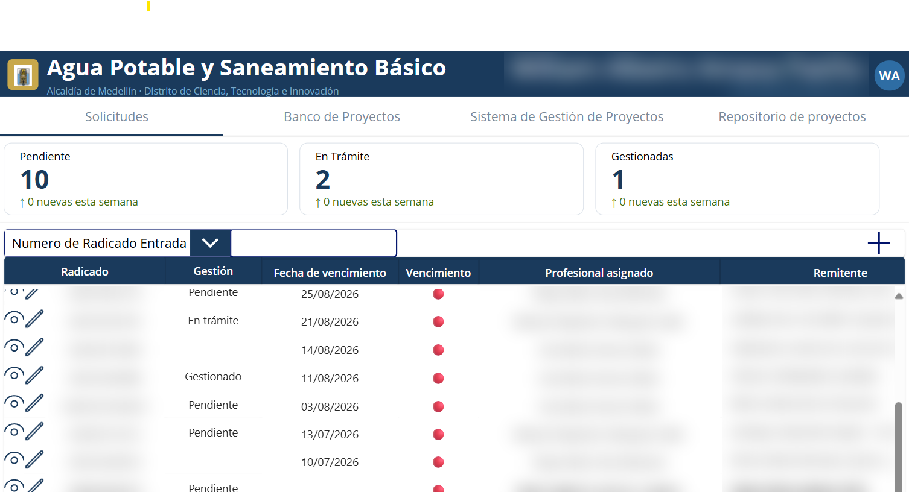

# Agua Potable y Saneamiento Básico

Aplicación de lienzo (Canvas App) de Power Apps para gestionar el ciclo de vida de proyectos de agua potable y saneamiento básico: desde la solicitud ciudadana hasta su viabilidad, priorización y seguimiento por fases.



*Módulo de Solicitudes: indicadores por estado, búsqueda por radicado y listado con semáforo de vencimiento (datos personales difuminados).*

## Módulos

| Módulo | Pantallas | Qué hace |
|---|---|---|
| Solicitudes | `MOD_SOLICITUDES`, `Sol-Datos Generales de la Solicitud`, `Sol-GestionSolicitud`, `Sol-Viabilidad` | Registro de radicados, asignación de profesional, visita técnica y concepto de viabilidad |
| Banco de proyectos | `MOD_BANCOPROYECTOS`, `Pri-GeneralesPriorizacion`, `Pri-Componente*` | Priorización por componentes técnico, jurídico, ambiental y administrativo |
| Repositorio de proyectos | `MOD_RPROYECTOS`, `Pro-GeneralesProyecto`, `Pro-AspectosGeneralesPro`, `Pro-FasesdelProyecto` | Ficha del proyecto y sus fases |
| Sistema de gestión | `MOD_SGPROYECTOS`, `Sgp_DetalleProyecto` | Seguimiento de fases y actividades por proyecto |

Componente reutilizable: `Comp_Encabezado` (encabezado con usuario, iniciales y navegación).

## Arquitectura

- **Origen de datos:** 6 listas de SharePoint Online (`Solicitudes`, `BancoProyectos`, `RepositorioProyectos`, `SistemaGestionProyectos`, `Fases`, `Actividades`). El esquema de columnas está en [esquema-listas.md](esquema-listas.md).
- **Conectores:** SharePoint y Usuarios de Office 365 (búsqueda de profesionales).
- **Formato:** teléfono, 1136 × 640.

## Estructura

```
src/            Código fuente de las pantallas en formato Power Fx YAML (.pa.yaml)
src/Components/ Componentes de lienzo
esquema-listas.md
```

## Cómo usarlo

El código en `src/` es para lectura y revisión. Para ejecutar la app:

1. Crea las listas de SharePoint según [esquema-listas.md](esquema-listas.md).
2. En Power Apps Studio crea una app de lienzo y conecta las listas con los mismos nombres.
3. Pega el YAML de cada pantalla (clic derecho en el árbol → *Pegar código*).

> Los datos, la URL del sitio de SharePoint y los identificadores del entorno original se omitieron a propósito. El dominio de correo aparece como `@dominio.gov.co`.
