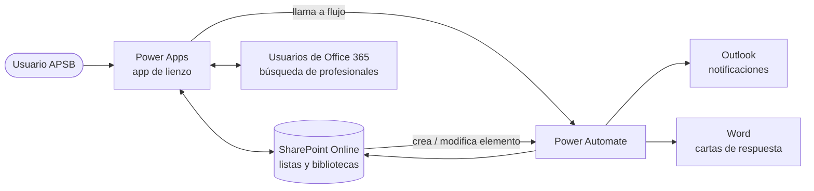
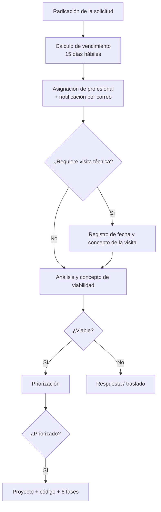

# Documentación técnica y funcional — Fase 1

**Gestión de Solicitudes · Agua Potable y Saneamiento Básico (APSB)**

| | |
|---|---|
| **Entidad** | Subsecretaría de Servicios Públicos — equipo APSB |
| **Tecnologías** | Power Apps, SharePoint Online, Power Automate, Outlook, Word |
| **Versión** | 1.0 · agosto de 2026 |

Este documento reúne la descripción funcional y técnica de la Fase 1: arquitectura, modelo de datos en SharePoint, componentes de Power Apps, automatizaciones, reglas de negocio, pruebas, operación y evoluciones previstas.

**Audiencia:** equipo funcional APSB, equipo de Transformación Digital/TI, administradores de SharePoint y Power Platform, y responsables de soporte.

---

## 1. Resumen ejecutivo

La Fase 1 implementa la gestión de solicitudes sobre Power Platform:

| Componente | Función principal | Resultado esperado |
|---|---|---|
| Power Apps | Interfaz de usuario para la gestión de solicitudes | Registro, consulta, edición, análisis y seguimiento desde una sola aplicación |
| SharePoint | Repositorio estructurado de información y documentos | Datos del proceso centralizados y trazables |
| Power Automate | Motor de automatización | Alertas, notificaciones, vencimientos, sincronizaciones y generación de documentos |
| Outlook / Word | Canales y salidas de apoyo | Correos de notificación y documentos de respuesta |

La solución reemplaza actividades dispersas o manuales por un flujo centralizado, trazable y controlado. La decisión funcional y técnica sigue en manos del equipo responsable del trámite.

## 2. Antecedentes y necesidad

Atender una solicitud implica registrar la radicación, asignar un profesional, controlar los tiempos, conservar los soportes, analizar la viabilidad y generar una respuesta. La Fase 1 reúne todo eso en una solución digital.

**Necesidades atendidas:**

- Centralizar los registros de solicitudes en una fuente única.
- Dar trazabilidad sobre responsable, estado, fechas y análisis.
- Controlar la fecha de vencimiento de cada trámite.
- Notificar al profesional asignado y generar alertas oportunas.
- Registrar la visita técnica y el análisis de viabilidad.
- Adjuntar el documento de la solicitud para conservar el contexto del trámite.
- Estandarizar el tipo de respuesta.
- Preparar la integración con priorización y gestión de proyectos.

## 3. Objetivo y alcance

**Objetivo general:** desarrollar una solución digital para la gestión de solicitudes del equipo APSB que integre Power Apps, SharePoint y Power Automate, y mejore el registro, el seguimiento, el control de tiempos, el análisis y la respuesta.

| Funcionalidad | Descripción | Estado en Fase 1 |
|---|---|---|
| Registro de solicitudes | Creación de registros con la información general del trámite | Incluido |
| Consulta y edición | Búsqueda, filtros y actualización de solicitudes existentes | Incluido |
| Asignación de profesional | Registro del profesional asignado y notificación asociada | Incluido |
| Visita técnica | Registro de si aplica visita, su fecha y su concepto | Incluido |
| Viabilidad | Registro del resultado del análisis y del concepto de viabilidad | Incluido |
| Adjuntos | Carga del documento de la solicitud y de los soportes | Incluido |
| Tipo de respuesta | Respuesta APSB, Traslado por competencia o Acuso de respuesta | Incluido |
| Vencimiento | Cálculo de 15 días hábiles y alertas de proximidad | Incluido |
| Priorización / Proyectos | Estructura y automatizaciones para continuar el ciclo cuando aplique | Incluido |

## 4. Arquitectura de la solución

La aplicación usa las listas de SharePoint como fuentes de datos, y los flujos de Power Automate actúan sobre los cambios del proceso.

**Responsabilidad de cada componente:**

- **Power Apps:** captura, visualización y edición de la información del trámite.
- **SharePoint:** persistencia de datos, adjuntos y relaciones entre registros.
- **Power Automate:** reglas automáticas, correos, sincronizaciones y documentos.
- **Outlook:** entrega de notificaciones al profesional o a los responsables.
- **Word / SharePoint:** plantillas y rutas de los documentos de respuesta generados.

## 5. Modelo de datos

El modelo lógico permite que una solicitud **viable** pase a priorización y que, si resulta **priorizada**, se convierta en un proyecto con sus fases. El detalle de cada columna está en [modelo-datos.md](modelo-datos.md).

### 5.1 Lista Solicitudes

| Campo | Tipo | Descripción / uso |
|---|---|---|
| SolicitudID | Texto, calculado en la app | Identificador visible de cuatro dígitos (ej. 0001) |
| Número radicado entrada | Texto | Radicado recibido. Con origen Mercurio se digita manualmente |
| Origen | Opción | Canal de origen de la solicitud |
| Remitente | Texto | Persona o entidad que presenta la solicitud |
| Asunto | Texto | Descripción breve del trámite |
| Comuna | Texto / opción | Comuna o ubicación asociada |
| Fecha radicado | Fecha | Fecha oficial de radicación |
| Fecha ingreso SSP | Fecha | Fecha de ingreso a la Subsecretaría, cuando aplique |
| Fecha visita técnica | Fecha | Solo si la solicitud requiere visita |
| Concepto visita | Texto multilínea | Resultado de la visita técnica |
| Fecha vencimiento | Fecha | Fecha límite calculada con 15 días hábiles |
| Próximo a vencer | Indicador | Marca que usan las automatizaciones para las alertas |
| Responsable / Profesional asignado | Persona | Profesional encargado de la gestión |
| Resultado del análisis | Texto / opción | Resultado del análisis funcional o técnico |
| Viabilidad | Opción | Viable / No viable |
| Concepto de viabilidad | Texto multilínea | Justificación del concepto |
| Tipo de respuesta | Opción | Respuesta APSB / Traslado por competencia / Acuso de respuesta |
| N.º radicado de respuesta | Texto | Radicado de la comunicación de salida |
| Estado | Opción | Estado vigente del trámite |
| Adjunto Solicitud | Adjunto | Documento de la solicitud y soportes |
| RutaCartaRespuesta / NombreCartaRespuesta / EstadoCartaRespuesta | Texto | Datos del documento de respuesta generado |

### 5.2 Lista Priorización

Identifica la solicitud que continúa (Número radicado), quién prioriza (Persona) y el resultado final (Concepto final). La evalúa con criterios ponderados: calidad del agua, continuidad, cobertura, estudios técnicos, componentes jurídico, ambiental y administrativo, y un **Resultado de evaluación** consolidado.

### 5.3 Lista Proyectos

Código de proyecto con estructura `APSB-[tipo]-[comuna]-[consecutivo]`, nombre, descripción, tipo de sistema (AC / AL), ubicación, radicado de origen, contrato, contratista, presupuesto, ejecución financiera, estados, ruta del informe de visita, observaciones y prioridad.

### 5.4 Relaciones y reglas de sincronización

- Una solicitud solo pasa a Priorización cuando su viabilidad lo permite.
- Cuando el concepto final de Priorización es *Priorizado*, se crea o actualiza el registro en Proyectos.
- Al crear un proyecto se generan automáticamente sus 6 fases.

## 6. Aplicación Power Apps

La aplicación centraliza la interacción del usuario. En la Fase 1 el foco está en el módulo de **Solicitudes**, con navegación hacia los demás componentes del ciclo de proyecto.

| Pantalla / módulo | Propósito | Funciones |
|---|---|---|
| Encabezado | Identidad visual, usuario y navegación | Acceso a cada módulo |
| Solicitudes — listado | Galería de registros y filtros | Buscar por radicado, profesional o concepto de viabilidad |
| Datos generales | Información básica de la solicitud | Crear y editar los datos de radicación |
| Gestión de solicitud | Responsable, fechas, visita y seguimiento | Registrar el avance de la gestión |
| Viabilidad | Resultado del análisis, concepto y tipo de respuesta | Emitir y conservar el concepto |
| Priorización | Proceso posterior | Continuidad del trámite viable |
| Proyectos | Ciclo de proyecto | Seguimiento posterior a la priorización |

**Funcionalidades implementadas:**

- Crear y editar solicitudes.
- Filtrar por número de radicado, profesional asignado y concepto de viabilidad.
- Elegir el profesional asignado buscando entre los usuarios de Microsoft 365.
- Registrar la visita técnica de forma condicionada.
- Cargar archivos adjuntos.
- Registrar el resultado del análisis, la viabilidad y el concepto.
- Elegir el tipo de respuesta.
- Generar la carta de respuesta (pendiente de licencia).
- Exportar a Excel cuando está habilitado.

**Variables y lógica relevante:**

| Elemento | Uso |
|---|---|
| `varFormData` | Registro seleccionado o en edición |
| `varEsNuevo` | Indica si se está creando un registro nuevo |
| `varSaved` | Resultado del guardado |
| `varFormMode` | Modo del formulario |
| `Patch` / `SubmitForm` | Guardan la información en SharePoint |
| Validaciones | Impiden guardar registros incompletos o inconsistentes |

**Consideraciones de interfaz:**

- Usar anchos y posiciones responsivos para evitar diferencias entre el editor y producción.
- El nombre del usuario debe adaptarse a distintas longitudes sin invadir el avatar.
- Los campos condicionados, como la visita técnica, deben ser coherentes entre `Visible`, `Update` y el valor guardado.
- Los campos de tipo Persona deben conservar el esquema que espera SharePoint para evitar errores en `Patch`.

## 7. Automatizaciones (Power Automate)

| Flujo | Disparador | Acción principal | Resultado |
|---|---|---|---|
| [Calcular vencimiento 15 días hábiles](flujos/calcular-vencimiento-15-dias-habiles.md) | Creación de solicitud | Calcula el vencimiento sin contar fines de semana ni festivos | Solicitud con fecha límite |
| [Actualizar próximo de vencimiento](flujos/actualizar-proximo-vencimiento.md) | Programado (Recurrence) | Recalcula los días que faltan y alerta | Seguimiento preventivo |
| [Enviar carta próximo a vencer](flujos/enviar-carta-proximo-vencer.md) | Programado / condición | Identifica las solicitudes próximas a vencer y notifica | Alerta oportuna |
| [Notificar profesional asignado](flujos/notificar-profesional-asignado.md) | Asignación o cambio de profesional | Envía un correo con los datos del trámite y el plazo | Profesional informado |
| [Generar carta de respuesta](flujos/generar-carta-respuesta.md) | Llamada desde Power Apps | Llena una plantilla de Word según la viabilidad | Documento de respuesta (pendiente de licencia) |
| [Sincronizar Solicitudes → Priorización](flujos/sincronizar-solicitudes-priorizacion.md) | Viabilidad = Viable | Crea el registro en Priorización | Continuidad del ciclo |
| [Sincronizar Priorización → Proyectos](flujos/sincronizar-priorizacion-proyectos.md) | Concepto final = Aprobado / Priorizado | Crea el proyecto | Proyecto vinculado |
| [Generar código de proyecto](flujos/generar-codigo-proyecto.md) | Creación o modificación de proyecto | Asigna el código `APSB-AC-99-0001` | Código estructurado |
| [Crear fases al registrar proyecto](flujos/crear-fases.md) | Creación de proyecto | Crea las 6 fases del ciclo de vida | Fases inicializadas |

### 7.1 Lógica de vencimiento

- El plazo es de **15 días hábiles**, contados desde el día siguiente a la fecha de radicado.
- No se cuentan sábados, domingos ni festivos. Los festivos están parametrizados en una lista de SharePoint.
- Se envía una alerta preventiva unos tres días antes del vencimiento.

> «Se informa que usted cuenta con un plazo de 15 días hábiles para gestionar el trámite correspondiente, contados a partir de la fecha de radicado.»

## 8. Reglas de negocio

| ID | Regla |
|---|---|
| RN-01 | El trámite tiene 15 días hábiles para su gestión |
| RN-02 | El conteo del vencimiento excluye fines de semana y festivos parametrizados |
| RN-03 | Con origen Mercurio el radicado se digita manualmente; con otros orígenes se genera automáticamente |
| RN-04 | La información de visita técnica solo se pide cuando la solicitud requiere visita |
| RN-05 | La viabilidad se registra como Viable o No viable, junto con su análisis y concepto |
| RN-06 | Solo una solicitud viable pasa a priorización |
| RN-07 | Un registro con concepto final Priorizado pasa a crear o actualizar el proyecto |
| RN-08 | El código de proyecto sigue la estructura `APSB-AC-99-0001`: prefijo, tipo de sistema, ubicación y consecutivo |
| RN-09 | El tipo de respuesta es Respuesta APSB, Traslado por competencia o Acuso de respuesta |
| RN-10 | La decisión de viabilidad es del profesional o del equipo; la automatización no reemplaza el criterio técnico |

## 9. Pruebas y validaciones

En la Fase 1 se hicieron pruebas funcionales con usuarios y se incorporaron los ajustes que pidieron antes de pasar a producción.

| Prueba | Descripción | Estado |
|---|---|---|
| Crear solicitud | Registro de una solicitud nueva | Validado |
| Editar solicitud | Actualización de información existente | Validado (sujeto a validación final de campos específicos) |
| Asignar profesional | Selección de la persona y notificación | Validado |
| Adjuntar solicitud | Carga del documento de contexto | Validado |
| Visita técnica | Mostrar y guardar la fecha y el concepto cuando corresponde | Validado |
| Viabilidad | Guardar el resultado del análisis y el concepto | Validado |
| Tipo de respuesta | Selección posterior al análisis | Incorporado |
| Cálculo de vencimiento | Aplicación de los 15 días hábiles | Validado |
| Alertas y correos | Envío al responsable y alertas de próximo a vencer | Validado |

**Ajustes incorporados a pedido de los usuarios:** mensaje de 15 días hábiles en el correo inicial, campo «Adjunto Solicitud», campo «Tipo de Respuesta», encabezado adaptable al largo del nombre y corrección de la persistencia de los campos Persona.

## 10. Despliegue y operación

| Elemento | Validación antes de producción |
|---|---|
| Aplicación Power Apps | Versión publicada, conexiones correctas y permisos asignados |
| Listas SharePoint | Columnas, tipos, permisos y vistas vigentes |
| Flujos Power Automate | Activados, sin errores, con propietarios y conexiones válidos |
| Festivos y parámetros | Fechas actualizadas para el periodo |
| Plantillas y documentos | Rutas y permisos de lectura y escritura |
| Usuarios | Acceso a la aplicación y a los recursos |

**Operación y mantenimiento:**

- Revisar periódicamente las ejecuciones fallidas de los flujos.
- Mantener al día la lista de festivos.
- Registrar los cambios en el control de versiones.
- Hacer pruebas de regresión después de modificar formularios, columnas o conectores.
- Documentar cada automatización nueva antes de pasarla a producción.

## 11. Limitaciones y consideraciones

| Tema | Consideración |
|---|---|
| Licenciamiento | Algunos conectores, como la automatización de Word o Dataverse, pueden requerir licencias adicionales |
| SharePoint | Hay que tener en cuenta los límites de delegación, los tipos de columna y el rendimiento a medida que crece el volumen |
| Campos Persona | Un valor vacío o mal estructurado provoca errores en `Patch` |
| Diseño responsivo | La app puede verse distinta en el editor y en producción si el escalado no es consistente |
| Plantillas | Dependen de las rutas, los permisos y los conectores disponibles |
| Continuidad | Los propietarios de la app, las listas y los flujos deben estar vigentes para no depender de una sola cuenta |

## 12. Posibles evoluciones (Fase 2+)

- Asistente con Copilot o IA para resumir solicitudes.
- Extracción automática de datos de los adjuntos con AI Builder.
- Paneles de indicadores de tiempos, estados, vencimientos y carga de trabajo.
- Más automatización del ciclo Priorización → Proyectos → Fases.
- Integración con sistemas institucionales o APIs autorizadas.
- Gestión centralizada de parámetros y catálogos.
- Mejoras de diseño responsivo.

## 13. Anexos

| Anexo | Contenido |
|---|---|
| 1 | [Manual de usuario — módulo de Solicitudes](manual-usuario-solicitudes.md) |
| 2 | [Modelo de datos (MER)](modelo-datos.md) |
| 3 | [Documentación de los flujos de Power Automate](README.md#flujos-de-power-automate) |
| 4 | Evidencias de pruebas de usuario *(no se publican: contienen datos personales)* |
| 5 | Matriz de festivos: lista de SharePoint `Festivos` que consultan los flujos de vencimiento |
