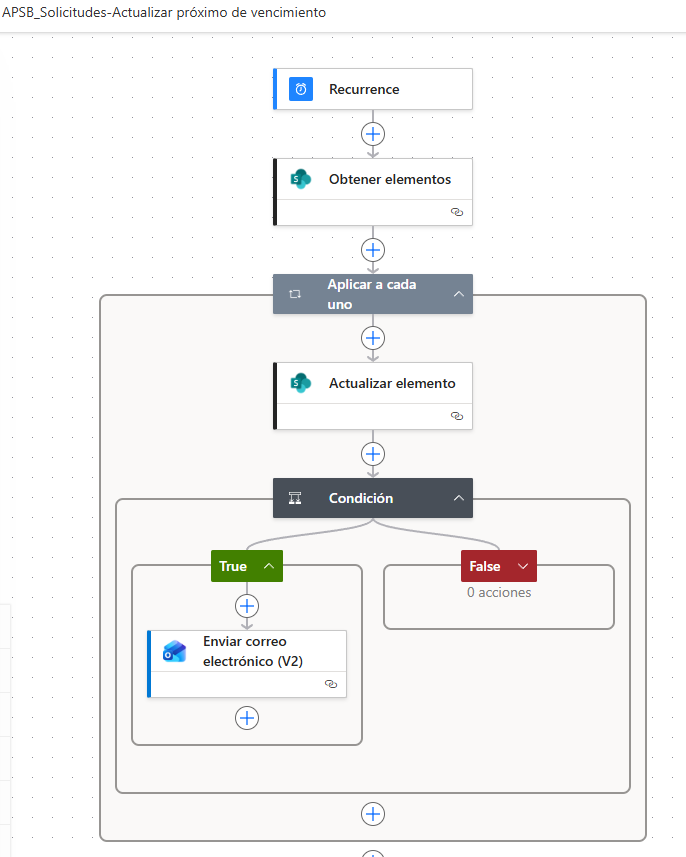

Documentación del flujo  
Actualizar próximo de vencimiento

Flujo: APSB\_Solicitudes-Actualizar próximo de vencimiento

| **Proceso**              | El flujo actualiza el campo Próximo a vencer (días) en la lista Solicitudes y, cuando se cumple la condición configurada, envía una notificación por correo electrónico. |
|--------------------------|--------------------------------------------------------------------------------------------------------------------------------------------------------------------------|
| **Fecha de elaboración** | 20/04/2026                                                                                                                                                               |

|     |
|-----|
|     |

# 1. Objetivo

Documentar de manera detallada el funcionamiento del flujo de Power Automate **APSB\_Solicitudes-Actualizar próximo de vencimiento**, el cual se ejecuta de forma programada para recorrer los registros de la lista **Solicitudes**, actualizar el campo **Próximo a vencer (días)** y, si se cumple la regla configurada en la condición del flujo, enviar una notificación por correo electrónico.

# 2. Alcance

> **•** Aplica a la lista de SharePoint Solicitudes.
>
> **•** Automatiza el cálculo o la actualización periódica del valor asociado al vencimiento de cada solicitud.
>
> **•** Permite generar alertas preventivas cuando el caso entra en el criterio de notificación definido dentro del flujo.

# 3. Vista general del flujo

De acuerdo con la imagen suministrada, el flujo tiene la siguiente secuencia funcional:

| **Paso** | **Acción**                     | **Tipo**              | **Propósito**                                                                                  |
|----------|--------------------------------|-----------------------|------------------------------------------------------------------------------------------------|
| 1        | Recurrence                     | Disparador programado | Inicia el flujo automáticamente con la periodicidad definida.                                  |
| 2        | Obtener elementos              | SharePoint            | Consulta los registros de la lista Solicitudes que serán procesados.                           |
| 3        | Aplicar a cada uno             | Control               | Recorre uno a uno los elementos obtenidos en el paso anterior.                                 |
| 4        | Actualizar elemento            | SharePoint            | Actualiza el valor del campo Próximo a vencer (días) y demás campos obligatorios del registro. |
| 5        | Condición                      | Control               | Evalúa si el elemento cumple la regla definida para notificar.                                 |
| 6        | Enviar correo electrónico (V2) | Outlook               | Envía la alerta al destinatario configurado cuando la condición es verdadera.                  |

# 4. Diagrama del flujo

La siguiente imagen corresponde al flujo actualmente configurado:

*Figura 1. Estructura general del flujo APSB\_Solicitudes-Actualizar próximo de vencimiento.*

# 5. Configuración detallada paso a paso

## 5.1. Recurrence

**Función:** disparar el flujo automáticamente sin intervención manual.

> **•** Frecuencia recomendada: diaria.
>
> **•** Intervalo sugerido: 1 día.
>
> **•** Hora sugerida: en la mañana, antes de iniciar la jornada operativa (por ejemplo, 7:00 a. m.).
>
> **•** Ventaja: garantiza que el campo Próximo a vencer (días) permanezca actualizado todos los días.

## 5.2. Obtener elementos

**Función:** consultar en SharePoint todos los registros que deben ser evaluados.

> **•** Sitio de SharePoint: seleccionar el sitio donde se encuentra la lista Solicitudes.
>
> **•** Nombre de la lista: Solicitudes.
>
> **•** Uso recomendado: traer todos los elementos activos o, si se desea optimizar, aplicar un filtro OData para consultar solo los registros que tengan fecha de vencimiento.

## 5.3. Aplicar a cada uno

**Función:** iterar cada elemento retornado por la acción Obtener elementos.

> Dentro de este contenedor se ejecutan, en orden, la actualización del registro y la validación para el envío del correo.

## 5.4. Actualizar elemento

**Función:** guardar en SharePoint el valor actualizado del campo **Próximo a vencer (días)** y mantener la información obligatoria del elemento.

Configuración mínima sugerida para esta acción:

| **Campo**                    | **Valor recomendado**                                                                                      |
|------------------------------|------------------------------------------------------------------------------------------------------------|
| Id                           | ID dinámico del elemento actual.                                                                           |
| Título y campos obligatorios | Mapear nuevamente los valores actuales del registro para evitar que SharePoint deje información en blanco. |
| Fecha de vencimiento         | Valor actual del elemento.                                                                                 |
| Próximo a vencer (días)      | Resultado del cálculo de diferencia entre la fecha de vencimiento y la fecha actual.                       |

Ejemplo técnico de expresión para calcular los días restantes:

<table><tbody><tr class="odd"><td>int( 
div( 
sub( 
ticks(formatDateTime(items('Aplicar_a_cada_uno')?['Fecha_x0020_de_x0020_vencimiento'],'yyyy-MM-dd')), 
ticks(formatDateTime(convertTimeZone(utcNow(),'UTC','SA Pacific Standard Time'),'yyyy-MM-dd')) 
), 
864000000000 
) 
)</td></tr></tbody></table>

**Interpretación:** la expresión elimina la hora, compara la fecha de vencimiento con la fecha actual ajustada a Colombia y devuelve el número entero de días restantes.

**Observación técnica importante:** como en la imagen la acción **Actualizar elemento** está antes de la **Condición**, si la condición debe evaluar el valor recién calculado, conviene reutilizar la misma expresión en la condición o almacenar el resultado previamente en una acción **Compose** para evitar evaluar un valor anterior del registro.

## 5.5. Condición

**Función:** determinar si el elemento debe generar una alerta por correo.

> En la rama True del flujo se ejecuta el envío de correo; en la rama False no se ejecutan acciones.

**Regla de negocio:** la condición puede configurarse según la necesidad del proceso. Algunos ejemplos frecuentes son:

> **–** Enviar correo cuando el valor de Próximo a vencer (días) sea igual a 3.
>
> **–** Enviar correo cuando falten 5 o 10 días.
>
> **–** No enviar correo cuando el caso ya fue gestionado o cuando el estado no corresponda.

Ejemplo de lógica para evaluar varios valores:

<table><tbody><tr class="odd"><td>or( 
equals(&lt;valor_proximo_a_vencer&gt;, 5), 
equals(&lt;valor_proximo_a_vencer&gt;, 10) 
)</td></tr></tbody></table>

## 5.6. Enviar correo electrónico (V2)

**Función:** notificar al responsable o profesional asignado cuando el caso cumpla la condición configurada.

> **•** Destinatario: correo del profesional asignado u otro responsable definido por el proceso.
>
> **•** Asunto sugerido: Alerta de vencimiento - solicitud próxima a vencer.
>
> **•** Contenido sugerido: número de radicado, fecha de radicado, fecha de vencimiento, días restantes y mensaje de atención prioritaria.

# 6. Campos involucrados

| **Campo**                       | **Tipo**        | **Uso en el flujo**                                                                         |
|---------------------------------|-----------------|---------------------------------------------------------------------------------------------|
| Fecha de vencimiento            | Fecha           | Base para calcular los días restantes.                                                      |
| Próximo a vencer (días)         | Número          | Campo que se actualiza con el resultado del cálculo.                                        |
| Profesional asignado / correo   | Persona o texto | Se utiliza como destinatario de la notificación, según configuración del flujo.             |
| ID                              | Sistema         | Permite identificar y actualizar el elemento correcto.                                      |
| Campos obligatorios de la lista | Varios          | Deben mapearse nuevamente en Actualizar elemento para conservar la integridad del registro. |

# 7. Lógica funcional resumida

| **Momento**                  | **Comportamiento del flujo**                                     |
|------------------------------|------------------------------------------------------------------|
| **Inicio del día**           | El flujo se activa automáticamente por Recurrence.               |
| **Consulta de datos**        | Se leen los elementos de la lista Solicitudes.                   |
| **Procesamiento individual** | Cada elemento se toma dentro del Aplicar a cada uno.             |
| **Actualización**            | Se recalcula y guarda el valor de Próximo a vencer (días).       |
| **Validación**               | Se revisa si el registro entra en el criterio de notificación.   |
| **Notificación**             | Si la condición es verdadera, se envía el correo al responsable. |

# 8. Validaciones y recomendaciones

> **•** Verificar que el campo Próximo a vencer (días) sea de tipo numérico en SharePoint.
>
> **•** Confirmar que Fecha de vencimiento esté diligenciada en los registros que deban participar en el proceso.
>
> **•** Si se quieren evitar valores negativos, agregar una condición adicional para guardar 0 cuando la fecha ya haya vencido.
>
> **•** Si la lista tiene muchos registros, considerar el uso de filtros OData para optimizar el rendimiento del flujo.
>
> **•** Mantener trazabilidad del envío de correos cuando el proceso lo requiera, por ejemplo registrando fecha de notificación o estado de gestión.

# 9. Resultado esperado

Con este flujo en operación, la lista Solicitudes queda actualizada de forma periódica respecto a los días restantes para el vencimiento de cada caso. Adicionalmente, los responsables reciben alertas oportunas cuando los registros cumplen la regla definida en la condición, lo que fortalece el seguimiento, la priorización y la gestión preventiva de las solicitudes.

# 10. Texto ejecutivo breve

Se documentó el flujo APSB\_Solicitudes-Actualizar próximo de vencimiento, configurado en Power Automate para ejecutarse de forma periódica, consultar la lista Solicitudes, actualizar el campo Próximo a vencer (días) y enviar un correo electrónico cuando el registro cumpla la condición de alerta definida. Esta automatización mejora el control de vencimientos y facilita el seguimiento oportuno de las solicitudes.
