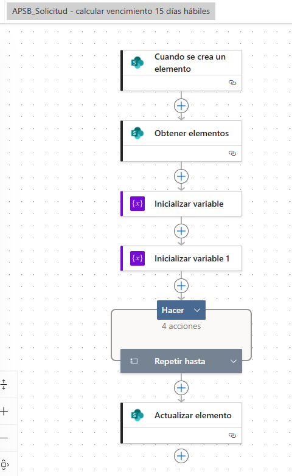

**DOCUMENTACIÓN TÉCNICA**

APSB\_Solicitud - calcular vencimiento 15 días hábiles

Power Automate · SharePoint · Lista Solicitudes

| **Flujo**                 | APSB\_Solicitud - calcular vencimiento 15 días hábiles                                                           |
|---------------------------|------------------------------------------------------------------------------------------------------------------|
| **Propósito**             | Calcular automáticamente la fecha de vencimiento con base en 15 días hábiles posteriores a la fecha de radicado. |
| **Fecha del documento**   | 19 de abril de 2026                                                                                              |

Documento elaborado para soporte funcional y técnico del flujo implementado en el proceso APSB.

# 1. Objetivo del flujo

El flujo “APSB\_Solicitud - calcular vencimiento 15 días hábiles” automatiza el cálculo de la fecha de vencimiento para cada registro de la lista Solicitudes en SharePoint. Su finalidad es asegurar que el plazo se establezca de forma uniforme, evitando cálculos manuales y garantizando consistencia operativa dentro del proceso de atención de solicitudes.

La lógica funcional definida es la siguiente: a partir de la fecha de radicado del elemento, el flujo cuenta quince días hábiles, excluyendo sábados y domingos, y luego actualiza el campo Fecha de vencimiento del mismo registro.

# 2. Alcance

Esta automatización aplica a los registros creados en la lista de SharePoint denominada Solicitudes. El flujo se ejecuta de manera automática al momento de la creación del elemento y realiza el cálculo de la fecha sin intervención del usuario final.

# 3. Estructura general del flujo

De acuerdo con la configuración observada, el flujo está compuesto por las siguientes acciones principales:

| **N.º** | **Acción**                 | **Tipo**                 | **Descripción funcional**                                                                                                        |
|---------|----------------------------|--------------------------|----------------------------------------------------------------------------------------------------------------------------------|
| 1       | Cuando se crea un elemento | Disparador de SharePoint | Inicia la ejecución automática del flujo cada vez que se crea un nuevo registro en la lista Solicitudes.                         |
| 2       | Obtener elementos          | SharePoint               | Consulta información complementaria de la lista o de otra fuente definida dentro del flujo, según la configuración implementada. |
| 3       | Inicializar variable       | Variables                | Crea la primera variable requerida para el conteo o manejo de la fecha base.                                                     |
| 4       | Inicializar variable 1     | Variables                | Crea la segunda variable necesaria para controlar el número de días hábiles o almacenar la fecha temporal.                       |
| 5       | Repetir hasta              | Control                  | Ejecuta iteraciones sucesivas hasta completar los 15 días hábiles definidos en la lógica.                                        |
| 6       | Actualizar elemento        | SharePoint               | Guarda en el elemento la fecha de vencimiento calculada.                                                                         |

# 4. Evidencia visual de la estructura

La siguiente imagen corresponde a la estructura general del flujo configurado en Power Automate:

Figura 1. Vista general del flujo APSB\_Solicitud - calcular vencimiento 15 días hábiles.

# 5. Parametrización recomendada del flujo

## 5.1 Disparador: Cuando se crea un elemento

Este paso debe configurarse con el sitio de SharePoint correspondiente y con la lista Solicitudes. Su función es detectar cada nuevo registro para iniciar el cálculo automáticamente.

> • Sitio de SharePoint: sitio donde se aloja la lista Solicitudes.
>
> • Nombre de la lista: Solicitudes.
>
> • Evento: creación de un nuevo elemento.

## 5.2 Acción: Obtener elementos

En la estructura mostrada aparece una acción Obtener elementos. Dependiendo del diseño final del flujo, esta acción puede utilizarse para validar información, consultar festivos en una lista auxiliar o recuperar datos adicionales necesarios para el cálculo. Si el flujo únicamente excluye sábados y domingos, esta acción podría no ser indispensable; sin embargo, si también se desean excluir festivos oficiales, resulta útil para consultar un repositorio de fechas no laborables.

## 5.3 Variables

Se recomienda que las variables mínimas del flujo sean las siguientes:

| **Variable**     | **Tipo**       | **Ejemplo de valor inicial**      | **Uso dentro del flujo**                                   |
|------------------|----------------|-----------------------------------|------------------------------------------------------------|
| FechaTemporal    | Cadena o fecha | Fecha de radicado                 | Almacena la fecha que se va incrementando día a día.       |
| ContadorHabiles  | Entero         | 0                                 | Cuenta los días hábiles acumulados hasta llegar a 15.      |
| FechaVencimiento | Cadena o fecha | Vacía o igual a Fecha de radicado | Guarda el resultado final antes de actualizar el elemento. |

## 5.4 Control: Repetir hasta

El bloque Repetir hasta constituye el núcleo de la lógica. En cada iteración el flujo avanza un día sobre la fecha temporal y valida si dicho día corresponde a un día hábil. Si la fecha cae entre lunes y viernes, incrementa el contador. Cuando el contador alcanza el valor quince, el ciclo finaliza.

# 6. Lógica funcional paso a paso

> **1.** El flujo se activa cuando se crea un nuevo elemento en la lista Solicitudes.
>
> **2.** Se toma la fecha de radicado del elemento como fecha base del cálculo.
>
> **3.** Se inicializa una fecha temporal y un contador de días hábiles en cero.
>
> **4.** Dentro del bloque Repetir hasta, la fecha temporal se incrementa un día.
>
> **5.** Se evalúa si el nuevo día corresponde a sábado o domingo.
>
> **6.** Si no es fin de semana, se incrementa el contador de días hábiles.
>
> **7.** Cada vez que el contador aumenta, la fecha temporal vigente puede almacenarse como fecha de vencimiento provisional.
>
> **8.** Al llegar a 15 días hábiles, el flujo sale del ciclo.
>
> **9.** Finalmente, la acción Actualizar elemento guarda la fecha de vencimiento calculada en el registro de SharePoint.

# 7. Expresiones recomendadas

A continuación se incluyen expresiones estándar útiles para implementar esta lógica en Power Automate. Los nombres exactos pueden ajustarse a la convención usada dentro del flujo.

## 7.1 Avanzar un día sobre la fecha temporal

addDays(variables('FechaTemporal'), 1)

## 7.2 Validar si la fecha corresponde a lunes a viernes

and(  
not(equals(dayOfWeek(variables('FechaTemporal')), 0)),  
not(equals(dayOfWeek(variables('FechaTemporal')), 6))  
)

En esta validación, el valor 0 representa domingo y el valor 6 representa sábado. Cualquier valor entre 1 y 5 corresponde a un día hábil.

## 7.3 Finalización del ciclo

variables('ContadorHabiles') is equal to 15

La condición del bloque Repetir hasta debe finalizar únicamente cuando el contador de días hábiles alcance el valor quince.

## 7.4 Actualización del elemento

Al terminar el ciclo, la acción Actualizar elemento debe guardar la fecha resultante en la columna Fecha de vencimiento del mismo registro que disparó el flujo.

# 8. Recomendaciones técnicas

> **•** Verificar que la columna Fecha de radicado esté diligenciada en el momento de la creación del registro.
>
> **•** Confirmar el nombre interno real de la columna Fecha de vencimiento en SharePoint para evitar errores al actualizar el elemento.
>
> **•** Si se requiere excluir festivos oficiales además de sábados y domingos, mantener una lista auxiliar de festivos y consultar esas fechas desde la acción Obtener elementos.
>
> **•** Si en el futuro el disparador cambia a Cuando se crea o modifica un elemento, agregar controles para evitar bucles de actualización.
>
> **•** Probar el flujo con varias fechas de radicado, incluyendo viernes, fines de mes y cierres de año, para validar el comportamiento.

# 9. Beneficios del flujo

La implementación de esta automatización aporta estandarización, reduce errores manuales, mejora la trazabilidad del proceso y facilita el seguimiento de los tiempos de respuesta de las solicitudes. Asimismo, permite que la lista de SharePoint mantenga un dato de vencimiento consistente y actualizado desde el momento en que se registra la solicitud.

# 10. Mantenimiento y futuras mejoras

Como línea de mejora, el flujo puede ampliarse para considerar calendarios de festivos, alertas automáticas de próximo vencimiento, notificaciones al profesional asignado y validaciones adicionales sobre estados o tipos de solicitud. También puede integrarse con otros flujos del ecosistema APSB para fortalecer la trazabilidad del ciclo completo de la solicitud.

# 11. Control documental

| **Nombre del documento**  | Documentación técnica del flujo APSB\_Solicitud - calcular vencimiento 15 días hábiles |
|---------------------------|----------------------------------------------------------------------------------------|
| **Versión**               | 1.0                                                                                    |
| **Observación**           | Documento preparado como soporte funcional y técnico del flujo en Power Automate.      |

Fin del documento
