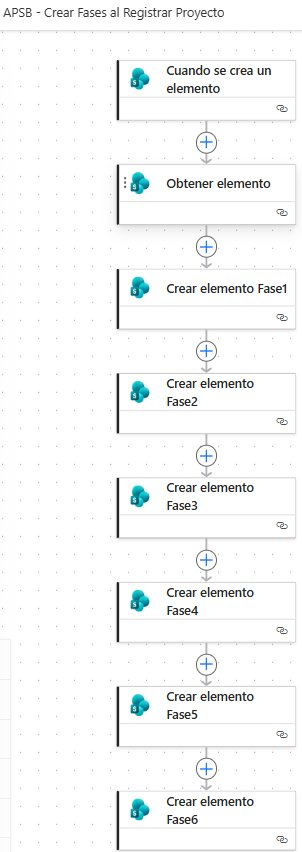

**SUBSECRETARÍA DE SERVICIOS PÚBLICOS**

Componente APSB — Sistema de Gestión de Proyectos

**DOCUMENTACIÓN TÉCNICA**

**Flujo de Automatización**

**APSB – Crear Fases al Registrar Proyecto**

Versión 1.0 • Mayo 2026

Herramienta: Microsoft Power Automate (Nube)

Plataforma: SharePoint Online — &lt;tenant&gt;.sharepoint.com

# 1. Información general del flujo

| **Nombre del flujo**          | APSB – Crear Fases al Registrar Proyecto        |
|-------------------------------|-------------------------------------------------|
| **Tipo de flujo**             | Flujo de nube automatizado                      |
| **Plataforma**                | Microsoft Power Automate                        |
| **Entorno**                   | Componente\_APSB – &lt;tenant&gt;.sharepoint.com |
| **Lista de origen (trigger)** | RepositorioProyectos                            |
| **Lista de destino**          | Fases                                           |
| **Versión**                   | 1.0                                             |
| **Fecha de creación**         | Mayo 2026                                       |
| **Estado**                    | Activo                                          |
| **Dependencia**               | Subsecretaría de Servicios Públicos — APSB      |

# 2. Objetivo

Automatizar la creación de las seis fases del ciclo de vida de un proyecto en la lista Fases de SharePoint, en el momento exacto en que un nuevo proyecto es registrado en la lista RepositorioProyectos. El flujo elimina la necesidad de crear manualmente cada fase, garantiza que todos los proyectos sigan la misma estructura de fases y reduce el margen de error en la carga de información.

# 3. Alcance

El flujo aplica a todos los proyectos que sean registrados en la lista RepositorioProyectos del sitio Componente\_APSB. Cada vez que se crea un elemento nuevo en dicha lista, el flujo genera automáticamente seis registros en la lista Fases, uno por cada etapa del proceso:

-   1 - Planeación

-   2 - Diseño

-   3 - Contratación

-   4 - Ejecución

-   5 - Cierre

-   6 - Liquidación

# 4. Listas de SharePoint involucradas

## 4.1 RepositorioProyectos (lista de origen)

Lista principal del sistema donde se registran los proyectos de la Subsecretaría. El flujo escucha esta lista para detectar nuevos registros.

| **Campo**           | **Tipo**      | **Descripción**                                 |
|---------------------|---------------|-------------------------------------------------|
| **ID**              | Número (auto) | Identificador autonumérico de SharePoint        |
| **Código proyecto** | Texto         | Código único del proyecto (ej. APSB-AC-90-0001) |
| **Nombre interno**  | Texto         | C\_x00f3\_digoproyecto                          |

## 4.2 Fases (lista de destino)

Lista donde se almacenan las fases de cada proyecto. El flujo crea seis registros por proyecto en esta lista.

| **Campo**                          | **Tipo** | **Valor inicial**  | **Descripción**                     |
|------------------------------------|----------|--------------------|-------------------------------------|
| **ProyectoID**                     | Texto    | Código proyecto    | Vincula la fase con su proyecto     |
| **FaseID**                         | Número   | 1 al 6             | Identificador numérico de la fase   |
| **Nombre de la Fase**              | Opción   | Ver tabla de fases | Nombre de la etapa del proyecto     |
| **Estado**                         | Opción   | Pendiente          | Estado inicial de la fase           |
| **Orden**                          | Número   | 1 al 6             | Secuencia de ejecución de las fases |
| **Porcentaje de Avance**           | Número   | 0                  | Avance inicial de la fase           |
| **Fecha de Inicio**                | Fecha    | Vacío              | Lo completa el gestor del proyecto  |
| **Fecha de Finalización Estimada** | Fecha    | Vacío              | Lo completa el gestor del proyecto  |

# 5. Estructura del flujo

El flujo está compuesto por ocho acciones que se ejecutan de forma secuencial. La siguiente imagen muestra el flujo tal como fue construido en Power Automate, seguida de la descripción detallada de cada paso:

*Figura 1. Estructura del flujo APSB – Crear Fases al Registrar Proyecto en Power Automate*

| **Paso** | **Nombre de la Acción**    | **Descripción**                                                                                          | **Resultado**                               |
|----------|----------------------------|----------------------------------------------------------------------------------------------------------|---------------------------------------------|
| **1**    | Cuando se crea un elemento | Trigger automático que detecta la creación de un nuevo elemento en la lista RepositorioProyectos.        | Inicia la ejecución del flujo               |
| **2**    | Obtener elemento           | Recupera el registro completo del proyecto recién creado usando el ID numérico entregado por el trigger. | Disponibiliza todos los campos del proyecto |
| **3**    | Crear elemento Fase1       | Crea el registro de la fase Planeación en la lista Fases vinculado al proyecto.                          | Fila creada: 1 - Planeación                 |
| **4**    | Crear elemento Fase2       | Crea el registro de la fase Diseño en la lista Fases.                                                    | Fila creada: 2 - Diseño                     |
| **5**    | Crear elemento Fase3       | Crea el registro de la fase Contratación en la lista Fases.                                              | Fila creada: 3 - Contratación               |
| **6**    | Crear elemento Fase4       | Crea el registro de la fase Ejecución en la lista Fases.                                                 | Fila creada: 4 - Ejecución                  |
| **7**    | Crear elemento Fase5       | Crea el registro de la fase Cierre en la lista Fases.                                                    | Fila creada: 5 - Cierre                     |
| **8**    | Crear elemento Fase6       | Crea el registro de la fase Liquidación en la lista Fases.                                               | Fila creada: 6 - Liquidación                |

# 6. Configuración detallada de cada acción

## 6.1 Trigger — Cuando se crea un elemento

| **Campo**               | **Valor configurado**                                                         | **Observación**                    |
|-------------------------|-------------------------------------------------------------------------------|------------------------------------|
| **Conector**            | SharePoint                                                                    |                                    |
| **Dirección del sitio** | Componente\_APSB – &lt;tenant&gt;.sharepoint.com/sites/&lt;sitio&gt; | Sitio de SharePoint Online         |
| **Nombre de lista**     | RepositorioProyectos                                                          | Lista de proyectos del sistema SGP |

## 6.2 Obtener elemento

| **Campo**               | **Valor configurado**               | **Observación**                            |
|-------------------------|-------------------------------------|--------------------------------------------|
| **Conector**            | SharePoint                          |                                            |
| **Dirección del sitio** | Componente\_APSB                    | Mismo sitio del trigger                    |
| **Nombre de lista**     | RepositorioProyectos                |                                            |
| **Identificador**       | ID (contenido dinámico del trigger) | ID autonumérico del proyecto recién creado |

## 6.3 Crear elemento Fase1 a Fase6

Las seis acciones de creación de fases tienen la misma configuración base. Solo varían los campos FaseID, Nombre de la Fase y Orden.

| **Campo**                          | **Valor configurado**                 | **Observación**                                                |
|------------------------------------|---------------------------------------|----------------------------------------------------------------|
| **Dirección del sitio**            | Componente\_APSB                      | Mismo sitio del trigger                                        |
| **Nombre de lista**                | Fases                                 | Lista de destino                                               |
| **ProyectoID**                     | Código proyecto (de Obtener elemento) | outputs('Obtener\_elemento')?\['body/C\_x00f3\_digoproyecto'\] |
| **Estado Value**                   | Pendiente                             | Estado inicial fijo para todas las fases                       |
| **Porcentaje de Avance**           | 0                                     | Valor numérico inicial                                         |
| **Fecha de Inicio**                | Vacío                                 | Lo diligencia el gestor posteriormente                         |
| **Fecha de Finalización Estimada** | Vacío                                 | Lo diligencia el gestor posteriormente                         |
| **Fecha final Real**               | Vacío                                 | Lo diligencia el gestor al cerrar la fase                      |

| **Acción**           | **FaseID** | **Nombre de la Fase** | **Orden** |
|----------------------|------------|-----------------------|-----------|
| Crear elemento Fase1 | 1          | 1 - Planeación        | 1         |
| Crear elemento Fase2 | 2          | 2 - Diseño            | 2         |
| Crear elemento Fase3 | 3          | 3 - Contratación      | 3         |
| Crear elemento Fase4 | 4          | 4 - Ejecución         | 4         |
| Crear elemento Fase5 | 5          | 5 - Cierre            | 5         |
| Crear elemento Fase6 | 6          | 6 - Liquidación       | 6         |

# 7. Resultado esperado al ejecutar el flujo

Cada vez que se registra un proyecto nuevo en RepositorioProyectos, el flujo crea automáticamente seis registros en la lista Fases con la siguiente estructura:

| **ProyectoID**  | **FaseID** | **Nombre de la Fase** | **Estado** | **Orden** |
|-----------------|------------|-----------------------|------------|-----------|
| APSB-AC-90-0001 | 1          | 1 - Planeación        | Pendiente  | 1         |
| APSB-AC-90-0001 | 2          | 2 - Diseño            | Pendiente  | 2         |
| APSB-AC-90-0001 | 3          | 3 - Contratación      | Pendiente  | 3         |
| APSB-AC-90-0001 | 4          | 4 - Ejecución         | Pendiente  | 4         |
| APSB-AC-90-0001 | 5          | 5 - Cierre            | Pendiente  | 5         |
| APSB-AC-90-0001 | 6          | 6 - Liquidación       | Pendiente  | 6         |

# 8. Consideraciones técnicas

-   El flujo solo se activa con proyectos nuevos. Los proyectos registrados antes de la creación del flujo deben procesarse con un flujo complementario de ejecución única.

-   El campo Código proyecto tiene como nombre interno en SharePoint C\_x00f3\_digoproyecto, debido a la codificación URL de la letra ó. Esto debe tenerse en cuenta al construir expresiones en Power Automate.

-   La acción Obtener elemento es necesaria para acceder al campo Código proyecto, ya que el trigger no siempre expone todos los campos con nombres especiales.

-   Si se requiere agregar o eliminar fases en el futuro, se debe modificar el flujo y actualizar las opciones del campo Nombre de la Fase en la lista Fases de SharePoint.

# 9. Control de cambios

| **Versión** | **Fecha** | **Responsable**              | **Descripción del cambio**                 |
|-------------|-----------|------------------------------|--------------------------------------------|
| 1.0         | Mayo 2026 | — | Creación inicial del flujo y documentación |
