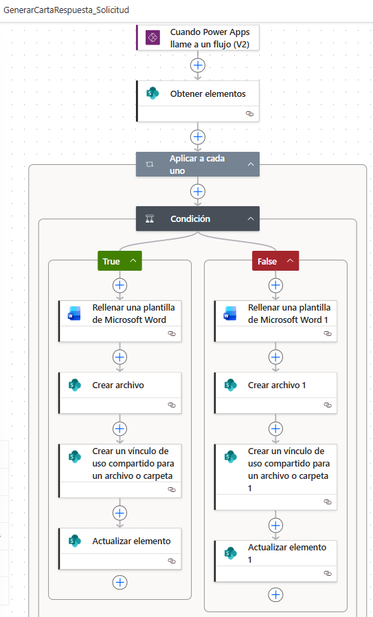
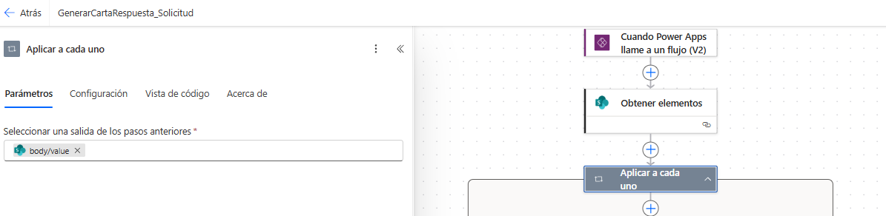
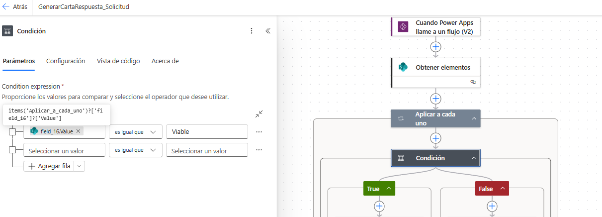
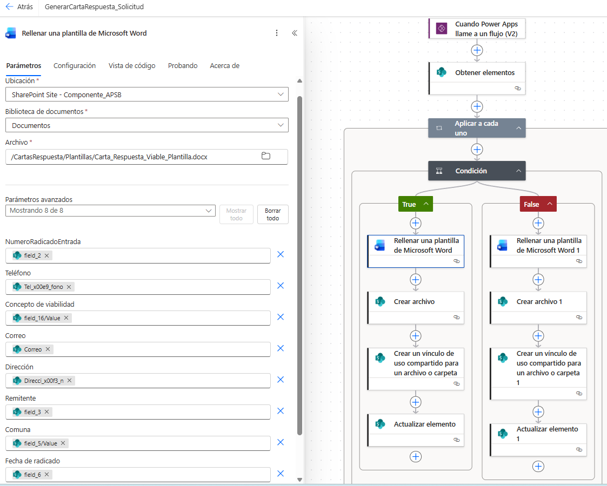

**Documentación técnica del flujo**

GenerarCartaRespuesta\_Solicitud

Proyecto Power Apps · gestión del ciclo de solicitudes, priorización y proyectos

|                                                                                                                                                                |
|----------------------------------------------------------------------------------------------------------------------------------------------------------------|
| Proceso documentado con base en las consultas realizadas sobre Power Apps, Power Automate, SharePoint y generación de cartas de respuesta dentro del proyecto. |

| **Documento**    | Documentación técnica del flujo “GenerarCartaRespuesta\_Solicitud”                            |
|------------------|-----------------------------------------------------------------------------------------------|
| **Proyecto**     | Power Apps – Ciclo de solicitudes, priorización y proyectos                                   |
| **Propósito**    | Generar y almacenar cartas de respuesta a partir de plantillas de Word y datos de SharePoint. |
| **Herramientas** | Power Apps, Power Automate, SharePoint y Word Online (Business).                              |
| **Fecha**        | 20/04/2026                                                                                    |

|                                                                                                                                                                                                                                                                                                 |
|-------------------------------------------------------------------------------------------------------------------------------------------------------------------------------------------------------------------------------------------------------------------------------------------------|
| **Alcance.** Este documento describe la lógica general del flujo observado en la imagen suministrada y consolida las decisiones y recomendaciones trabajadas en el proyecto. Algunos nombres internos de columnas o rutas pueden variar en su ambiente y deben verificarse antes de producción. |

# 1. Propósito del flujo

El flujo **GenerarCartaRespuesta\_Solicitud** tiene como objetivo recibir una solicitud desde Power Apps, consultar la información del registro en SharePoint, evaluar una condición de negocio y generar automáticamente una carta de respuesta a partir de una plantilla de Word. Posteriormente, crea el archivo, genera un vínculo de acceso y actualiza el elemento origen con la trazabilidad del documento.

-   Reducir trabajo manual en la elaboración de respuestas.

-   Estandarizar el contenido de las cartas viables y no viables.

-   Guardar evidencia documental directamente en SharePoint.

-   Facilitar la consulta del documento generado desde Power Apps o desde la lista de Solicitudes.

# 2. Arquitectura funcional

El proceso integra varios componentes del ecosistema Microsoft 365. La siguiente tabla resume el papel de cada uno dentro de la solución:

| **Componente** | **Rol en el proceso**     | **Observación**                                                                  |
|----------------|---------------------------|----------------------------------------------------------------------------------|
| Power Apps     | Dispara el flujo          | Llama el flujo desde un botón, pasando el identificador del registro.            |
| SharePoint     | Fuente y destino de datos | Consulta la lista de Solicitudes y almacena el archivo generado o su vínculo.    |
| Word Online    | Rellena la plantilla      | Inserta datos del registro en la plantilla correspondiente.                      |
| Power Automate | Orquesta el proceso       | Evalúa la condición, genera el archivo, crea el vínculo y actualiza el elemento. |

|                                                                                                                                                                                                                                                    |
|----------------------------------------------------------------------------------------------------------------------------------------------------------------------------------------------------------------------------------------------------|
| **Recomendación.** Cuando el flujo se ejecuta desde Power Apps, conviene enviar al menos el ID del registro. Esto simplifica la consulta en SharePoint, evita ambigüedades y permite que el documento se asocie de manera exacta con la solicitud. |

# 3. Vista general del flujo

La imagen siguiente resume la estructura observada del flujo en Power Automate:

*Figura 1. Flujo general de GenerarCartaRespuesta\_Solicitud.*

-   El flujo inicia con el disparador de Power Apps (V2).

-   Luego consulta uno o varios registros en SharePoint mediante “Obtener elementos”.

-   Power Automate crea automáticamente un “Aplicar a cada uno” porque la acción anterior devuelve una colección.

-   Dentro del bucle se evalúa la condición que define qué plantilla debe usarse.

-   Cada rama rellena una plantilla Word, crea un archivo, genera un vínculo y actualiza el elemento origen.

# 4. Descripción detallada paso a paso

## 4.1. Disparador: “Cuando Power Apps llame a un flujo (V2)”

Este paso permite que la aplicación invoque el flujo desde un botón o una acción del usuario. La práctica recomendada es enviar un identificador único del registro, por ejemplo el ID de SharePoint o el número de radicado de entrada.

-   Entrada sugerida: ID del elemento o radicado.

-   Uso típico desde Power Apps: flujo.Run(ID\_del\_registro).

-   Ventaja: el flujo no depende del elemento seleccionado manualmente dentro de Power Automate.

## 4.2. Acción: “Obtener elementos”

Consulta la lista origen —en este proyecto, normalmente la lista Solicitudes— para recuperar la información que alimentará la carta. Debe filtrarse al máximo para evitar traer varios registros innecesarios.

-   Sitio: el sitio de SharePoint donde vive la lista.

-   Lista: Solicitudes (ajustar si en su ambiente tiene otro nombre).

-   Filtro sugerido: por N.° de radicado de entrada.

-   Top Count recomendado: 1, cuando el criterio de búsqueda es único.

<table><tbody><tr class="odd"><td>
<strong>Ejemplo de filtro por radicado</strong>
<blockquote>
field_2 eq '

@{triggerBody()['text']}'
</blockquote></td></tr></tbody></table>

*(Captura omitida en la versión pública: muestra datos del entorno institucional.)*

## 4.3. Acción automática: “Aplicar a cada uno”

Aunque se espere un único registro, “Obtener elementos” retorna un arreglo. Por eso Power Automate envuelve las acciones siguientes en un ciclo “Aplicar a cada uno”. Este comportamiento es normal y no representa un error.

-   Se puede dejar tal como está cuando el filtro ya controla que solo llegue un registro.

-   Si se desea evitar el bucle, puede evaluarse el uso de “Obtener elemento”, siempre que el ID ya exista como entrada confiable.

    

## 4.4. Acción: “Condición”

La condición determina qué plantilla debe usarse. En este proyecto se discutió que la lógica puede depender de la columna Concepto de viabilidad, según la definición de negocio vigente. Como suele tratarse de columnas de elección, es importante leer la propiedad Value y normalizar el texto.

## 4.5. Rama True

En la rama True se ejecuta la plantilla asociada al caso que cumple la condición. En muchos escenarios esto corresponde a la carta viable, aunque el significado real debe verificarse en la implementación.

1.  Rellenar una plantilla de Microsoft Word: inserta datos del registro en los controles de contenido del documento base.

2.  Crear archivo: guarda el documento generado en la biblioteca o carpeta definida de SharePoint.

3.  Crear un vínculo de uso compartido: produce una URL que luego puede mostrarse en la app o enviarse por correo.

4.  Actualizar elemento: registra en la lista el nombre del documento, la ruta o el estado de generación.

## 4.6. Rama False

En la rama False se replica la misma lógica, pero usando la segunda plantilla. Usualmente esta rama representa la carta no viable o la carta alternativa según la regla definida.

-   La estructura espejo entre ramas facilita el mantenimiento.

-   Se recomienda usar nombres claros para identificar qué plantilla pertenece a cada caso.

-   El paso de actualización debería diferenciar también el tipo de carta generada.

# 5. Configuración recomendada de las plantillas Word

Las plantillas deben almacenarse en SharePoint y contener controles de contenido con nombres consistentes. Esto es lo que permite que la acción de Word Online ubique y rellene cada dato.

-   Activar la pestaña Programador en Word.

-   Insertar controles de contenido de texto sin formato donde corresponda.

-   Asignar nombres claros y únicos a cada control.

-   Evitar renombrar controles después de mapearlos en Power Automate, a menos que también se actualice el flujo.

| **Dato en la plantilla**       | **Origen sugerido en SharePoint**     | **Comentario**                                                            |
|--------------------------------|---------------------------------------|---------------------------------------------------------------------------|
| Número de radicado de entrada  | field\_2 / N.° de radicado de entrada | Texto. Debe validarse el nombre interno real.                             |
| Remitente                      | Remitente                             | Texto o persona según el diseño de la lista.                              |
| Asunto                         | Asunto                                | Texto corto o multilínea.                                                 |
| Comuna / corregimiento         | Comuna o Comuna\_Corregimiento        | Si es columna de elección usar Value.                                     |
| Fecha de radicado              | Fecha de radicado                     | Formatear la fecha antes de insertarla si se requiere presentación local. |
| Fecha de visita técnica        | Fecha de visita técnica               | Puede quedar vacía si aún no existe visita.                               |
| Concepto de la visita          | Concepto de la visita                 | Normalmente texto largo.                                                  |
| N.° de radicado de respuesta   | N.° de radicado de respuesta          | Puede generarse en Power Apps o en otro flujo.                            |
| Fecha de radicado de respuesta | Fecha de radicado de respuesta        | Recomendable enviarla ya formateada.                                      |
| Viabilidad / concepto          | Viabilidad o field\_16                | Según la lógica definida en el proyecto.                                  |

# 6. Recomendaciones para el nombre del archivo y la trazabilidad

Durante el proyecto surgió la necesidad de impedir que un nuevo intento sobrescriba el documento anterior. Para ello, el nombre del archivo debe incluir un dato único, por ejemplo el radicado, el ID y una marca de tiempo.

<table><tbody><tr class="odd"><td>
<strong>Ejemplo de nombre único para el documento</strong>
<blockquote>
concat(

'Carta_',

replace(coalesce(items('Aplicar_a_cada_uno')?['field_2'], 'sin_radicado'), '/', '-'),

'_',

formatDateTime(utcNow(), 'yyyyMMdd_HHmmss'),

'.docx'

)
</blockquote></td></tr></tbody></table>

-   Guardar el nombre del archivo en una columna como NombreCartaRespuesta.

-   Guardar el vínculo o ruta en una columna como RutaCartaRespuesta.

-   Guardar un estado simple, por ejemplo: Generada, Error, Pendiente.

# 7. Integración con Power Apps

La aplicación puede ejecutar el flujo desde un botón después de guardar el formulario o desde una pantalla de detalle. También puede mostrar un mensaje al usuario con el resultado esperado.

<table><tbody><tr class="odd"><td>
<strong>Ejemplo orientativo desde Power Apps</strong>
<blockquote>
Set(

varResultadoCarta,

GenerarCartaRespuesta_Solicitud.Run(Text(varSaved.ID))

);

Notify(

"La carta se está generando. Verifica el vínculo en el registro en unos segundos.",

NotificationType.Success

);
</blockquote></td></tr></tbody></table>

-   Es mejor ejecutar el flujo después de que el registro esté guardado.

-   Si el flujo actualiza el mismo elemento, conviene hacer un Refresh de la lista al finalizar.

-   Si el vínculo tarda en aparecer, informar al usuario que el proceso puede tomar algunos segundos.

# 

# 11. Conclusión

El flujo GenerarCartaRespuesta\_Solicitud resuelve de forma estructurada la generación documental de respuestas dentro del proyecto Power Apps. Su valor principal está en la estandarización del proceso, la disminución de tareas manuales y la trazabilidad del documento dentro de SharePoint. Para que opere correctamente en producción, es indispensable validar el licenciamiento del conector de Word, los nombres internos de las columnas, el criterio exacto de la condición y la forma en la que se almacenará el vínculo del archivo generado.

|                                                                                                                                                                                                                      |
|----------------------------------------------------------------------------------------------------------------------------------------------------------------------------------------------------------------------|
| **Resultado esperado.** Una vez finalizada la implementación, el usuario podrá generar la carta desde Power Apps, encontrar el documento en SharePoint y consultar en el mismo registro la ruta o vínculo de acceso. |
