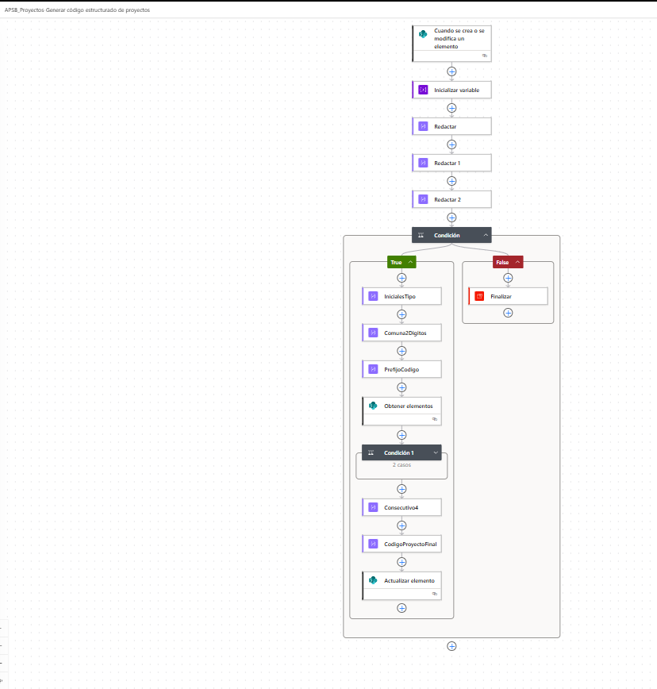

| **Nombre sugerido del flujo**       | generarCodigoEstructuradoDeProyectos                                                                                                                              |
|-------------------------------------|-------------------------------------------------------------------------------------------------------------------------------------------------------------------|
| **Objetivo**                        | Generar automáticamente el campo “Código proyecto” con la estructura APSB-XX-YY-ZZZZ a partir de Tipo de sistema, Comuna y un consecutivo ascendente por prefijo. |
| **Documento**                       | Guía funcional y técnica para configuración, validación y mantenimiento del flujo.                                                                                |

*Versión del documento: 1.0  
Fecha de elaboración: 21/03/2026*

Figura 1. Vista general del flujo documentado.

# Contenido

-   1\. Descripción general del proceso

-   2\. Regla de negocio del código

-   3\. Campos y nombres internos utilizados

-   4\. Estructura correcta del flujo

-   5\. Configuración paso a paso

-   6\. Expresiones clave del flujo

-   7\. Validación y pruebas recomendadas

-   8\. Errores comunes y cómo corregirlos

-   9\. Recomendaciones de administración y mantenimiento

# 1. Descripción general del proceso

Este flujo de Power Automate se ejecuta cuando se crea o modifica un elemento en la lista SharePoint “Proyectos”. Su función es asignar de forma automática un código estructurado al proyecto, evitando digitación manual, errores de nomenclatura y duplicidad de consecutivos. El proceso consulta los datos del elemento actual, calcula un prefijo a partir de Tipo de sistema y Comuna, busca el último código existente con ese mismo prefijo y, finalmente, actualiza el registro con el siguiente consecutivo disponible.

|                                                                                                                                                                                |
|--------------------------------------------------------------------------------------------------------------------------------------------------------------------------------|
| **Resultado esperado:** cada registro válido queda con un código como APSB-AC-99-0001, donde el último bloque incrementa en forma ascendente para cada combinación de prefijo. |

# 2. Regla de negocio del código

La estructura del código responde a la siguiente lógica de negocio:

| **Bloque** | **Origen**      | **Descripción**                                                                          |
|------------|-----------------|------------------------------------------------------------------------------------------|
| **APSB**   | Constante       | Prefijo fijo definido por la dependencia o proceso.                                      |
| **XX**     | Tipo de sistema | Se toman las dos primeras letras en mayúscula. Ej.: Acueducto → AC; Alcantarillado → AL. |
| **YY**     | Comuna          | Se toma el número de comuna y se fuerza a dos dígitos. Ej.: 1 → 01; 99 → 99.             |
| **ZZZZ**   | Consecutivo     | Número secuencial de cuatro dígitos que incrementa por cada prefijo APSB-XX-YY.          |

### Ejemplo completo:

<table><tbody><tr class="odd"><td>Tipo de sistema = Acueducto 
Comuna = 99 - Otros 
Código final = APSB-AC-99-0001</td></tr></tbody></table>

# 3. Campos y nombres internos utilizados

Antes de implementar o modificar el flujo, es indispensable confirmar los nombres internos de las columnas en SharePoint. Los nombres visibles pueden diferir de los nombres técnicos usados por Power Automate.

| **Campo visible** | **Nombre interno usado en el flujo** | **Tipo de dato**   | **Uso dentro del proceso**                                         |
|-------------------|--------------------------------------|--------------------|--------------------------------------------------------------------|
| Código proyecto   | C\_x00f3\_digoproyecto               | Texto              | Se valida que esté vacío y luego se actualiza con el código final. |
| Tipo de sistema   | field\_4                             | Choice / Selección | Se usa para obtener las dos iniciales del código.                  |
| Comuna            | field\_6                             | Choice / Selección | Se usa para extraer el número y formatearlo a dos dígitos.         |

|                                                                                                                                                                   |
|-------------------------------------------------------------------------------------------------------------------------------------------------------------------|
| **Importante:** si la lista se recrea, si las columnas se renombran o si cambian de tipo, se debe volver a validar el nombre interno y las expresiones del flujo. |

# 4. Estructura correcta del flujo

La estructura funcional recomendada es la siguiente:

<table><tbody><tr class="odd"><td>Cuando se crea o se modifica un elemento 
↓ 
Inicializar variable (varConsecutivo = 1) 
↓ 
Condición principal 
├─ True 
│ ├─ InicialesTipo 
│ ├─ Comuna2Digitos 
│ ├─ PrefijoCodigo 
│ ├─ Obtener elementos 
│ ├─ Condición 1 
│ │ ├─ True → Establecer variable (varConsecutivo = último + 1) 
│ │ └─ False → No hacer nada 
│ ├─ Consecutivo4 
│ ├─ CodigoProyectoFinal 
│ └─ Actualizar elemento 
└─ False 
└─ Finalizar</td></tr></tbody></table>

### Notas de diseño:

-   La acción “Inicializar variable” debe ir fuera de las condiciones. Si se ubica dentro de una condición, Power Automate genera el error InvalidVariableInitialization.

-   La acción “Actualizar elemento” debe quedar directa, sin “For each”, usando el ID del disparador.

-   La rama False puede finalizar el flujo o quedar sin acciones; en ambos casos la lógica es válida si el elemento no cumple los criterios para generar código.

# 5. Configuración paso a paso

## 5.1 Disparador

Agregar el disparador “Cuando se crea o se modifica un elemento”, seleccionar el sitio SharePoint correspondiente y la lista “Proyectos”. En la configuración del disparador se recomienda activar Control de concurrencia y dejar el grado en 1 para evitar duplicidad de consecutivos cuando existan cargas simultáneas.

## 5.2 Inicializar variable

Agregar “Inicializar variable” con nombre varConsecutivo, tipo Entero y valor 1. Esta variable actúa como valor base cuando no existen códigos previos con el mismo prefijo.

## 5.3 Condición principal

Validar que el elemento actual tenga Código proyecto vacío y que Tipo de sistema y Comuna tengan información. Solo si se cumple esta condición se debe continuar con la generación del código. Si no se cumple, la rama False finaliza o detiene el proceso.

## 5.4 Acción InicialesTipo

Crear una acción Redactar llamada “InicialesTipo”. Esta acción toma las dos primeras letras del campo Tipo de sistema y las convierte a mayúscula.

## 5.5 Acción Comuna2Digitos

Crear una acción Redactar llamada “Comuna2Digitos”. Esta acción extrae el número del campo Comuna y lo formatea a dos dígitos. En este entorno no debe usarse padLeft(); se usa formatNumber().

## 5.6 Acción PrefijoCodigo

Crear una acción Redactar llamada “PrefijoCodigo”. Esta acción une el prefijo fijo APSB, las iniciales del sistema y la comuna normalizada.

## 5.7 Acción Obtener elementos

Consultar la lista “Proyectos” para identificar si ya existe un código con ese mismo prefijo. Debe aplicarse un filtro OData startswith, ordenar por Código proyecto en orden descendente y traer solo el primer registro.

## 5.8 Condición 1

Evaluar si la consulta devolvió registros. Si existen, se toma el último consecutivo y se incrementa en 1. Si no existen, la variable se conserva en 1.

## 5.9 Acción Consecutivo4

Formatear la variable varConsecutivo a cuatro dígitos.

## 5.10 Acción CodigoProyectoFinal

Construir el código final concatenando PrefijoCodigo y Consecutivo4.

## 5.11 Acción Actualizar elemento

Actualizar el mismo elemento del disparador usando su ID y escribir el valor de CodigoProyectoFinal en la columna Código proyecto. Si la acción exige campos obligatorios adicionales, deben completarse con los valores actuales del elemento.

# 6. Expresiones clave del flujo

### Condición principal (lado izquierdo)

<table><tbody><tr class="odd"><td>and( 
equals(coalesce(triggerOutputs()?['body/C_x00f3_digoproyecto'],''),''), 
not(equals(coalesce(triggerOutputs()?['body/field_4/Value'],''),'')), 
not(equals(coalesce(triggerOutputs()?['body/field_6/Value'],''),'')) 
)</td></tr></tbody></table>

Comparar contra true.

### InicialesTipo

|                                                                          |
|--------------------------------------------------------------------------|
| toUpper(substring(triggerOutputs()?\['body/field\_4'\]?\['Value'\],0,2)) |

Ejemplo: Alcantarillado → AL.

### Comuna2Digitos

<table><tbody><tr class="odd"><td>formatNumber( 
int(trim(first(split(triggerOutputs()?['body/field_6']?['Value'],' - ')))), 
'00' 
)</td></tr></tbody></table>

Evita el error de padLeft no definido.

### PrefijoCodigo

|                                                                           |
|---------------------------------------------------------------------------|
| concat('APSB-', outputs('InicialesTipo'), '-', outputs('Comuna2Digitos')) |

Ejemplo: APSB-AL-99.

### Obtener elementos – Consulta de filtro

|                                                                                  |
|----------------------------------------------------------------------------------|
| concat('startswith(C\_x00f3\_digoproyecto,''', outputs('PrefijoCodigo'), '-'')') |

Filtra por prefijo.

### Obtener elementos – Ordenar por

|                             |
|-----------------------------|
| C\_x00f3\_digoproyecto desc |

Se escribe como texto normal, no como expresión.

### Obtener elementos – Primeros puestos

|     |
|-----|
| 1   |

Trae solo el código más alto para ese prefijo.

### Condición 1 (izquierda)

|                                                |
|------------------------------------------------|
| length(body('Obtener\_elementos')?\['value'\]) |

Comparar con “es mayor que 0”.

### Establecer variable

<table><tbody><tr class="odd"><td>add( 
int( 
last( 
split( 
first(body('Obtener_elementos')?['value'])?['C_x00f3_digoproyecto'], 
'-' 
) 
) 
), 
1 
)</td></tr></tbody></table>

Convierte el último bloque a entero y suma 1.

### Consecutivo4

|                                                  |
|--------------------------------------------------|
| formatNumber(variables('varConsecutivo'),'0000') |

Ejemplo: 8 → 0008.

### CodigoProyectoFinal

|                                                                |
|----------------------------------------------------------------|
| concat(outputs('PrefijoCodigo'), '-', outputs('Consecutivo4')) |

Ejemplo final: APSB-AL-99-0008.

# 7. Validación y pruebas recomendadas

| **Caso de prueba**                | **Datos de entrada**                                           | **Resultado esperado**   | **Observación**                         |
|-----------------------------------|----------------------------------------------------------------|--------------------------|-----------------------------------------|
| Primer proyecto con prefijo nuevo | Tipo de sistema = Acueducto; Comuna = 99 - Otros; Código vacío | APSB-AC-99-0001          | Obtener elementos devuelve \[\].        |
| Segundo proyecto mismo prefijo    | Existe APSB-AC-99-0001                                         | APSB-AC-99-0002          | Condición 1 entra por True.             |
| Registro sin Tipo de sistema      | Código vacío; Comuna con valor                                 | No genera código         | Debe salir por la rama False.           |
| Registro ya codificado            | Código proyecto ya diligenciado                                | No sobrescribe el código | La condición principal evita reproceso. |

# 8. Errores comunes y cómo corregirlos

| **Situación / mensaje**                                   | **Causa habitual**                                               | **Corrección recomendada**                                                           |
|-----------------------------------------------------------|------------------------------------------------------------------|--------------------------------------------------------------------------------------|
| InvalidVariableInitialization                             | Inicializar variable se ubicó dentro de una condición.           | Mover “Inicializar variable” justo después del disparador.                           |
| The template function padLeft is not defined or not valid | Uso de padLeft en este entorno.                                  | Reemplazar por formatNumber tanto en Comuna2Digitos como en Consecutivo4.            |
| Se crea automáticamente un For each                       | Se usó un valor de tipo colección dentro de Actualizar elemento. | Usar el ID del disparador y colocar Actualizar elemento fuera de cualquier For each. |
| La condición entra por False cuando no debería            | Nombre interno incorrecto o campo realmente vacío.               | Verificar nombres internos, tipos de columnas y valores reales del elemento.         |
| No encuentra códigos previos                              | Filtro OData o nombre interno del campo incorrecto.              | Revisar startswith, Ordenar por y “Primeros puestos = 1”.                            |

# 9. Recomendaciones de administración y mantenimiento

-   Configurar la columna “Código proyecto” como una línea de texto y, de ser posible, con valores únicos en SharePoint.

-   Mantener el Control de concurrencia del disparador en 1 para disminuir el riesgo de duplicidad cuando se creen registros simultáneos.

-   Documentar cualquier cambio de nombres internos de campos y actualizar inmediatamente las expresiones del flujo.

-   Conservar el flujo con un nombre técnico consistente, por ejemplo: generarCodigoEstructuradoDeProyectos.

*Fin del documento*
