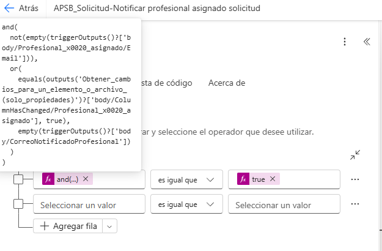

<table><tbody><tr class="odd"><td><strong>DOCUMENTACIÓN TÉCNICA DEL FLUJO 
NOTIFICAR PROFESIONAL ASIGNADO SOLICITUD</strong></td></tr></tbody></table>

Proyecto APSB – Power Automate / SharePoint / Power Apps

**Documento:** Versión de trabajo para soporte y transferencia técnica

**Fecha:** 2026

|                                                                                                                                                                                                                                                    |
|----------------------------------------------------------------------------------------------------------------------------------------------------------------------------------------------------------------------------------------------------|
| **Propósito del flujo:** Enviar una notificación por correo al profesional asignado cuando una solicitud sea creada con asignación o cuando cambie el profesional responsable, evitando envíos repetidos mediante una columna auxiliar de control. |

**1. Objetivo**

Configurar y documentar el flujo “Notificar profesional asignado solicitud” para asegurar que el profesional responsable reciba una notificación automática cuando se asigne una solicitud por primera vez o cuando la asignación cambie posteriormente.

**2. Alcance funcional**

-   Detecta eventos de creación o modificación sobre la lista SharePoint “Solicitudes”.

-   Valida si el campo Profesional asignado contiene correo electrónico.

-   Identifica si la asignación cambió o si nunca se había notificado antes.

-   Envía un correo al profesional asignado con información básica de la solicitud.

-   Actualiza la columna auxiliar CorreoNotificadoProfesional para evitar reenvíos innecesarios.

**3. Componentes involucrados**

| **Componente**                 | **Uso**                         | **Observaciones**                                                                         |
|--------------------------------|---------------------------------|-------------------------------------------------------------------------------------------|
| SharePoint – lista Solicitudes | Origen y actualización de datos | Contiene el campo Profesional asignado y la columna auxiliar CorreoNotificadoProfesional. |
| Power Automate                 | Automatización del proceso      | Ejecuta validación, envío de correo y actualización de control.                           |
| Office 365 Outlook             | Envío del correo electrónico    | Usado por la acción Enviar correo electrónico (V2).                                       |
| Power Apps                     | Interfaz de captura y edición   | Genera las actualizaciones que disparan el flujo.                                         |

**4. Estructura general del flujo**

El flujo queda conformado por cinco bloques funcionales principales:

-   Disparador: Cuando se crea o se modifica un elemento.

-   Detección de cambios: Obtener cambios para un elemento o archivo (solo propiedades).

-   Regla de decisión: Condición con expresión lógica para primer envío o cambio de asignación.

-   Acción de negocio: Enviar correo electrónico (V2).

-   Acción de control: Actualizar elemento para guardar el último correo notificado.

**5. Configuración paso a paso**

**5.1 Columna auxiliar en SharePoint**

Se debe crear en la lista “Solicitudes” la columna auxiliar CorreoNotificadoProfesional de tipo “Una sola línea de texto”. Su propósito es almacenar el correo del último profesional al que ya se notificó, de modo que el flujo no vuelva a enviar correo si el usuario da Guardar sin cambiar la asignación.

**5.2 Disparador**

Acción: “Cuando se crea o se modifica un elemento”.

-   Sitio: componente APSB / Subsecretaría de Servicios Públicos.

-   Lista: Solicitudes.

-   Entrega el valor actual de las columnas del elemento, incluyendo Profesional asignado y su Email.

**5.3 Obtener cambios**

Acción: “Obtener cambios para un elemento o archivo (solo propiedades)”.

-   Id: ID del elemento del disparador.

-   Desde: Trigger Window Start Token.

-   Permite evaluar si la columna Profesional asignado cambió realmente en la última transacción.

    *(Captura omitida en la versión pública: muestra datos del entorno institucional.)*

**5.4 Condición del flujo**

La condición usada en el flujo evalúa dos escenarios válidos para notificar:

-   Escenario 1: el profesional asignado tiene correo y la columna auxiliar CorreoNotificadoProfesional está vacía (primer envío).

-   Escenario 2: el profesional asignado tiene correo y la columna Profesional asignado fue modificada respecto a la versión anterior.

Expresión recomendada:

<table><tbody><tr class="odd"><td>and( 
not(empty(triggerOutputs()?['body/Profesional_x0020_asignado/Email'])), 
or( 
equals(outputs('Obtener_cambios_para_un_elemento_o_archivo_(solo_propiedades)')?['body/ColumnHasChanged/Profesional_x0020_asignado'], true), 
empty(triggerOutputs()?['body/CorreoNotificadoProfesional']) 
) 
)</td></tr></tbody></table>

**5.5 Enviar correo electrónico**

Acción: “Enviar correo electrónico (V2)”.

-   Para: Profesional asignado (correo actual del disparador).

-   Asunto: asignación de solicitud con el número de radicado o consecutivo.

-   Cuerpo: saludo, identificación del profesional, número de solicitud, fecha de radicado, instrucción de revisión y enlace de acceso a la aplicación o al registro.

    *(Captura omitida en la versión pública: muestra datos del entorno institucional.)*

**5.6 Actualizar elemento**

Después del envío del correo, el flujo debe ejecutar la acción “Actualizar elemento” sobre la misma lista Solicitudes para registrar el valor de control.

-   Sitio: mismo sitio del disparador.

-   Lista: Solicitudes.

-   Identificador: ID del elemento.

-   Campo CorreoNotificadoProfesional: correo actual del profesional asignado.

Expresión sugerida en el campo CorreoNotificadoProfesional:

|                                                                |
|----------------------------------------------------------------|
| triggerOutputs()?\['body/Profesional\_x0020\_asignado/Email'\] |

*(Captura omitida en la versión pública: muestra datos del entorno institucional.)*

**6. Lógica de funcionamiento esperada**

| **Caso**                  | **Profesional asignado**      | **CorreoNotificadoProfesional** | **Resultado esperado**                                                                         |
|---------------------------|-------------------------------|---------------------------------|------------------------------------------------------------------------------------------------|
| 1\. Primera asignación    | Tiene valor y correo          | Vacío                           | La condición da True, se envía correo y luego se actualiza la columna auxiliar.                |
| 2\. Guardado sin cambio   | Sin cambio                    | Ya contiene el mismo correo     | La condición da False. No se envía correo.                                                     |
| 3\. Cambio de profesional | Se reemplaza por otro usuario | Contiene correo anterior        | La condición da True, se envía correo al nuevo profesional y se actualiza la columna auxiliar. |
| 4\. Campo sin correo      | Vacío o sin Email             | Cualquiera                      | La condición da False. No se envía correo.                                                     |

**7. Consideraciones en Power Apps**

Desde la aplicación Power Apps, el campo Profesional asignado debe guardarse como columna Persona o grupo. El control del formulario puede ser un ComboBox vinculado a la columna SharePoint y su propiedad Update debe devolver el usuario seleccionado. El flujo no debe depender de comparaciones complejas en Power Apps para evitar duplicados; la prevención de reenvíos se controla mejor desde la columna auxiliar y la condición de Power Automate.

**8. Validaciones y pruebas recomendadas**

-   Prueba 1: crear una solicitud nueva con profesional asignado y confirmar que el correo salga una sola vez.

-   Prueba 2: guardar nuevamente el mismo registro sin modificar el profesional y verificar que no se reenvíe.

-   Prueba 3: cambiar el profesional por otro usuario y validar que el correo se envíe al nuevo responsable.

-   Prueba 4: revisar que la columna CorreoNotificadoProfesional quede actualizada con el correo vigente.

**9. Problemas frecuentes y solución**

| **Situación**                                      | **Acción correctiva**                                                                                                                                 |
|----------------------------------------------------|-------------------------------------------------------------------------------------------------------------------------------------------------------|
| El flujo no envía correo en la primera asignación. | Verificar que el campo Profesional\_x0020\_asignado/Email no esté vacío y que la condición use la ruta plana body/Profesional\_x0020\_asignado/Email. |
| El flujo reenvía correo al volver a guardar.       | Confirmar que la acción Actualizar elemento esté llenando CorreoNotificadoProfesional con el correo actual del profesional.                           |
| La condición no detecta cambios.                   | Revisar la acción Obtener cambios y asegurar que “Desde” sea Trigger Window Start Token.                                                              |
| Power Apps muestra Claims en lugar del nombre.     | Corregir el control de persona/ComboBox para mostrar DisplayName y guardar la selección de tipo Persona o grupo.                                      |

**10. Evidencia visual del flujo**

La siguiente captura ilustra la estructura de flujo implementada con su condición, rama verdadera, envío de correo y actualización del elemento.

*(Captura omitida en la versión pública: muestra datos del entorno institucional.)*

*Figura 1. Estructura del flujo “Notificar profesional asignado solicitud”.*
