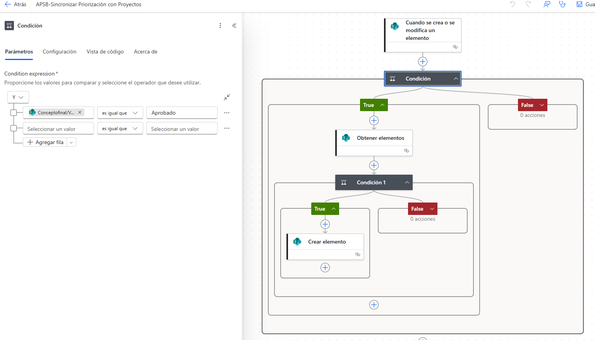
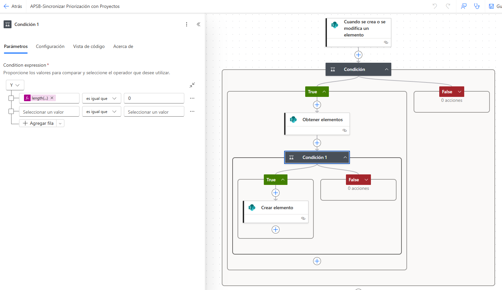
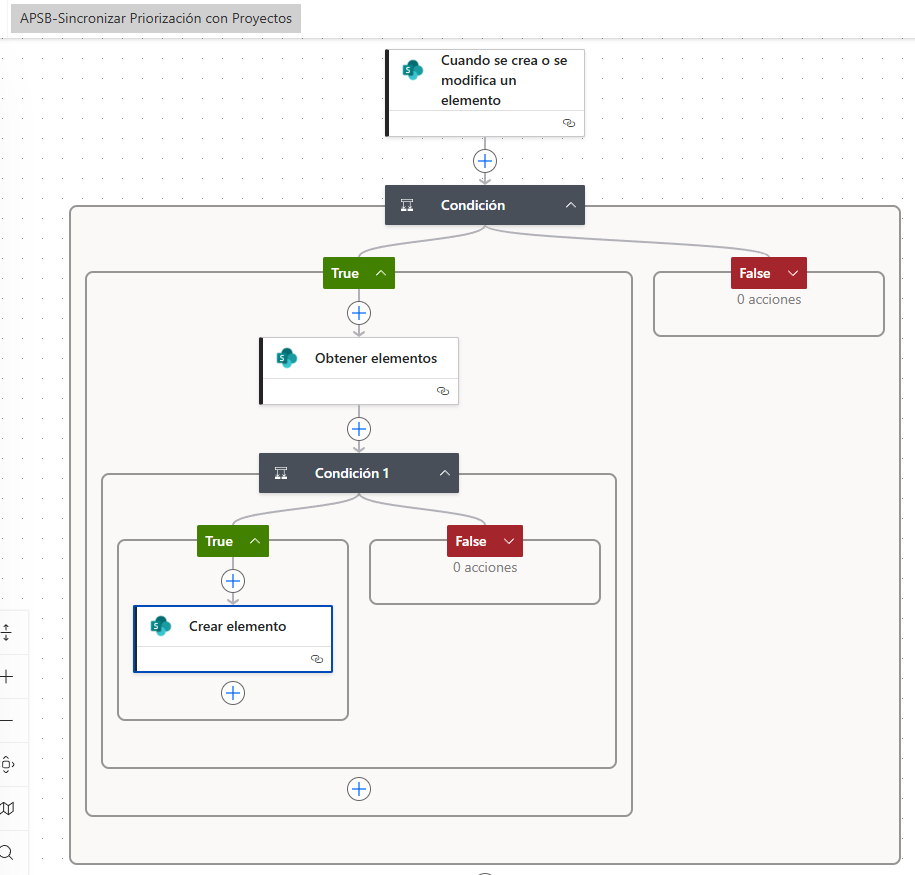

|                                     |
|-------------------------------------|
| **DOCUMENTACIÓN TÉCNICA DEL FLUJO** |

APSB-Sincronizar Priorización con Proyectos

Power Automate · SharePoint · Sincronización controlada entre listas

Fecha de elaboración del documento: 19 de abril de 2026

<table><tbody><tr class="odd"><td>
<strong>Propósito del flujo</strong>

Automatizar la creación controlada de registros en la lista <strong>Proyectos</strong> a partir de elementos del proceso de priorización que hayan quedado <strong>aprobados</strong>, evitando duplicados mediante una validación previa por número de radicado.
</td></tr></tbody></table>

# 1. Ficha técnica del flujo

| **Nombre del flujo**           | APSB-Sincronizar Priorización con Proyectos                                                                                          |
|--------------------------------|--------------------------------------------------------------------------------------------------------------------------------------|
| **Plataforma**                 | Microsoft Power Automate                                                                                                             |
| **Origen del disparador**      | Elemento creado o modificado en el proceso de priorización, de acuerdo con la lógica visible en las capturas.                        |
| **Sitio SharePoint**           | Componente\_APSB                                                                                                                     |
| **Lista consultada / destino** | Proyectos                                                                                                                            |
| **Objetivo operativo**         | Crear un registro en Proyectos solamente cuando el concepto final sea Aprobado y no exista un proyecto previo con el mismo radicado. |
| **Tipo de sincronización**     | Unidireccional: Priorización → Proyectos                                                                                             |

# 2. Descripción funcional

El flujo inicia con el disparador “Cuando se crea o se modifica un elemento”. Esto permite que la validación se ejecute tanto para registros nuevos como para actualizaciones posteriores dentro del proceso de priorización.

La primera decisión del flujo revisa el campo “Concepto final”. Solo cuando este valor es igual a “Aprobado” el proceso continúa con la búsqueda en la lista Proyectos. Si el resultado es diferente, la rama False no ejecuta acciones.

Luego se consulta la lista Proyectos filtrando por número de radicado. Con esta búsqueda se determina si ya existe un registro equivalente en la lista destino.

La segunda condición evalúa la cantidad de elementos encontrados. Cuando la longitud de la respuesta es igual a 0, el flujo crea un nuevo proyecto; en caso contrario, no realiza ninguna acción para evitar duplicidad.

| **Paso** | **Componente**             | **Lógica / criterio**                                           |
|----------|----------------------------|-----------------------------------------------------------------|
| 1        | Disparador                 | Se ejecuta al crear o modificar un elemento del proceso origen. |
| 2        | Condición principal        | Evalúa si Concepto final = Aprobado.                            |
| 3        | Obtener elementos          | Consulta la lista Proyectos con filtro por número de radicado.  |
| 4        | Condición de no duplicidad | Verifica que la cantidad de elementos encontrados sea 0.        |
| 5        | Crear elemento             | Solo se ejecuta cuando el proyecto no existe previamente.       |

# 3. Configuración paso a paso

## Paso 1. Disparador del flujo

Configurar el disparador de SharePoint “Cuando se crea o se modifica un elemento” sobre la lista de origen del proceso de priorización.

## Paso 2. Condición principal

Comparar el valor del campo interno Conceptofinal/Value contra el texto “Aprobado”. La rama True habilita la sincronización y la rama False queda sin acciones.

## Paso 3. Consulta a la lista Proyectos

Dentro de la rama True agregar “Obtener elementos” apuntando al sitio Componente\_APSB y a la lista Proyectos.

## Paso 4. Filtro por radicado

Usar el campo interno N\_x00fa\_meroderadicado para comparar el número de radicado del registro origen.

*(Captura omitida en la versión pública: muestra datos del entorno institucional.)*

## Paso 5. Validación de no existencia

Aplicar la expresión length(body('Obtener\_elementos')?\['value'\]) y compararla con 0.

## Paso 6. Creación del proyecto

Si la condición anterior es verdadera, ejecutar “Crear elemento” en Proyectos. La captura evidencia al menos el mapeo del campo “Radicado de entrada (origen)” con el número de radicado del registro de priorización.

*(Captura omitida en la versión pública: muestra datos del entorno institucional.)*

## Paso 7. Control de duplicados

Si la longitud es mayor que 0, la rama False no realiza acciones y se evita crear registros repetidos.

# 4. Expresiones y campos técnicos identificados

| **Elemento**             | **Configuración**                                     | **Finalidad**                                       |
|--------------------------|-------------------------------------------------------|-----------------------------------------------------|
| Condición principal      | triggerBody()?\['Conceptofinal/Value'\] = 'Aprobado'  | Permite que solo continúen los registros aprobados. |
| Acción Obtener elementos | Lista: Proyectos                                      | Busca coincidencias previas en la lista destino.    |
| Consulta de filtro       | N\_x00fa\_meroderadicado eq \[Número de radicado...\] | Filtra la búsqueda por radicado.                    |
| Condición 1              | length(body('Obtener\_elementos')?\['value'\]) = 0    | Comprueba que no existan proyectos asociados.       |
| Crear elemento           | Radicado de entrada (origen) ← Número radicado...     | Inserta el nuevo registro cuando aplica.            |

# 5. Evidencia visual del flujo

Captura suministrada del bloque de validación de no duplicidad y creación del elemento en la lista Proyectos.

Figura 1. Vista del bloque de validación de existencia y creación del proyecto.

# 6. Resultado esperado del flujo

> **•** Cuando un registro de priorización queda con Concepto final = Aprobado, el flujo consulta la lista Proyectos.
>
> **•** Si no encuentra un proyecto con el mismo número de radicado, crea automáticamente el nuevo registro.
>
> **•** Si ya existe un proyecto asociado, no crea otro elemento y mantiene la integridad de la información.
>
> **•** Si el concepto final no es Aprobado, el flujo no ejecuta ninguna acción adicional.

<table><tbody><tr class="odd"><td>
<strong>Fin del documento</strong>

Documento listo para archivo, revisión y transferencia de conocimiento.
</td></tr></tbody></table>
