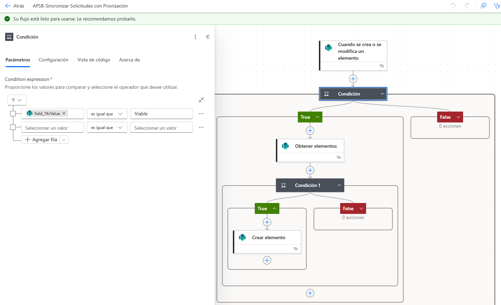
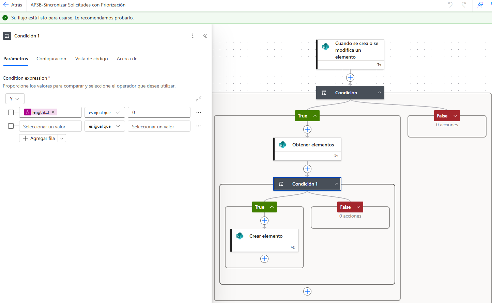
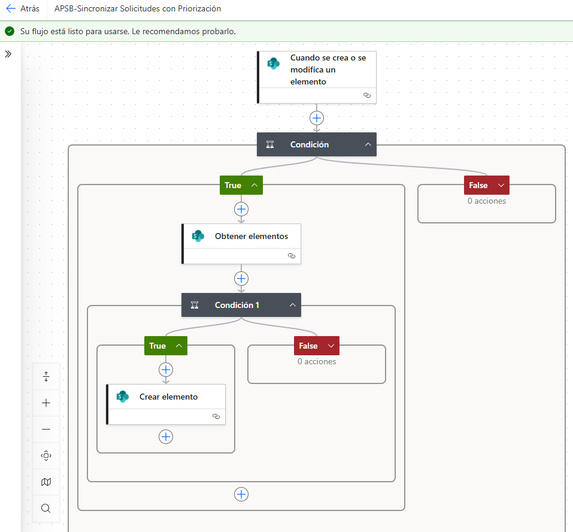

|                             |
|-----------------------------|
| **DOCUMENTACIÓN DEL FLUJO** |

APSB-Sincronizar Solicitudes  
con Priorización

Descripción funcional, configuración observada y comportamiento operativo del flujo en Power Automate

| **Nombre del flujo**      | APSB-Sincronizar Solicitudes con Priorización                                                        |
|---------------------------|------------------------------------------------------------------------------------------------------|
| **Plataforma**            | Microsoft Power Automate + SharePoint                                                                |
| **Propósito**             | Sincronizar registros de la lista de Solicitudes hacia la lista de Priorización evitando duplicados. |
| **Fecha del documento**   | 20/04/2026                                                                                           |

*Documento elaborado para soporte, mantenimiento y transferencia de conocimiento del flujo.*

# 1. Resumen ejecutivo

|                                                                                                                                                                                                                                                                                                                                                                                                                                                                                                                                                                     |
|---------------------------------------------------------------------------------------------------------------------------------------------------------------------------------------------------------------------------------------------------------------------------------------------------------------------------------------------------------------------------------------------------------------------------------------------------------------------------------------------------------------------------------------------------------------------|
| El flujo APSB-Sincronizar Solicitudes con Priorización se activa cuando un elemento es creado o modificado en la lista origen. A partir de una condición principal, el proceso valida si el registro debe continuar con la sincronización. En la rama verdadera consulta la lista Priorización, revisa si ya existe un elemento con el mismo radicado de entrada de origen y, únicamente si no encuentra coincidencias, crea el nuevo registro. Con esta lógica se evita la duplicidad de información y se garantiza trazabilidad entre Solicitudes y Priorización. |

# 2. Objetivo del flujo

> • Automatizar el paso controlado de información desde la etapa de Solicitudes hacia la lista de Priorización.
>
> • Evitar que un mismo radicado de entrada se cree más de una vez en la lista de destino.
>
> • Mantener una relación funcional entre el registro origen y el registro de priorización para facilitar seguimiento, análisis y consolidación posterior.

# 3. Alcance funcional

> • Se ejecuta a partir del disparador “Cuando se crea o se modifica un elemento”.
>
> • La lista de destino observada en la configuración es Priorizacion dentro del sitio Componente\_APSB.
>
> • La validación de existencia se realiza con base en el número de radicado de entrada / radicado de entrada de origen.
>
> • En el estado actual del flujo, la rama False de la condición principal y la rama False de la Condición 1 no ejecutan acciones.

# 4. Estructura general del flujo

| **Orden** | **Bloque**                               | **Tipo**            | **Descripción funcional**                                                                   |
|-----------|------------------------------------------|---------------------|---------------------------------------------------------------------------------------------|
| 1         | Cuando se crea o se modifica un elemento | Disparador          | Inicia el flujo al detectar creación o modificación de un registro en la lista origen.      |
| 2         | Condición                                | Control lógico      | Define si el registro cumple el criterio para continuar con la sincronización.              |
| 3         | Obtener elementos                        | Consulta SharePoint | Busca en Priorizacion si ya existe un elemento relacionado con el mismo radicado.           |
| 4         | Condición 1                              | Validación          | Comprueba si la consulta devolvió cero registros; es decir, que aún no existe coincidencia. |
| 5         | Crear elemento                           | Acción SharePoint   | Crea el elemento en Priorizacion solo cuando no hay duplicado.                              |

# 5. Configuración detallada por bloque

## 5.1 Disparador: Cuando se crea o se modifica un elemento

Este bloque es el punto de inicio del flujo. Su función es escuchar cambios sobre la lista origen y disparar automáticamente la lógica de sincronización. Dado el nombre del flujo y la secuencia observada, la intención funcional es tomar información proveniente de Solicitudes y evaluar si debe reflejarse en Priorización.

## 5.2 Condición principal

La condición principal actúa como compuerta de negocio. En las capturas se observa que únicamente la rama True continúa con la consulta a Priorización, mientras que la rama False no tiene acciones configuradas. Esto indica que solo ciertos registros cumplen el criterio para ser sincronizados.

## 5.3 Acción: Obtener elementos

**Configuración observada:** sitio **Componente\_APSB**, lista **Priorizacion**.

Esta acción consulta la lista de destino para identificar si ya existe un registro equivalente. La consulta de filtro compara el campo interno asociado a “Radicado de entrada (origen)” de Priorización contra el “Número radicado entrada” proveniente del elemento disparador.

<table><thead><tr class="header"><th><strong>Consulta lógica observada: 
Radicado de entrada (origen) eq &lt;Número radicado entrada del elemento origen&gt;</strong></th></tr></thead><tbody><tr class="odd"><td></td></tr></tbody></table>

## *(Captura omitida en la versión pública: muestra datos del entorno institucional.)*

## 5.4 Condición 1: validación de existencia

La segunda condición revisa el tamaño del arreglo devuelto por Obtener elementos. La expresión visible en la configuración es:

|                                                        |
|--------------------------------------------------------|
| **length(body('Obtener\_elementos')?\['value'\]) = 0** |

**Interpretación:** si la longitud del arreglo es igual a cero, no existe todavía un registro relacionado en Priorización. Por lo tanto, el flujo entra a la rama True y procede a crear el elemento.

## 5.5 Acción: Crear elemento

Esta acción se ejecuta únicamente cuando la condición anterior valida que no existe un registro previo. En la evidencia visible se observa mapeado, como mínimo, el campo “Numero radicado entrada”, lo que confirma que el dato clave de sincronización se transfiere hacia la lista Priorizacion.

*(Captura omitida en la versión pública: muestra datos del entorno institucional.)*

# 6. Datos utilizados para la sincronización

| **Dato**                       | **Uso dentro del flujo**                                                      | **Observación**                                             |
|--------------------------------|-------------------------------------------------------------------------------|-------------------------------------------------------------|
| Número radicado entrada        | Sirve como identificador del registro origen y como dato a copiar en destino. | Es el dato visible y mapeado en Crear elemento.             |
| Radicado de entrada (origen)   | Se usa en la consulta de filtro de Priorización.                              | Su nombre interno aparece codificado por SharePoint.        |
| Resultado de Obtener elementos | Define si existe o no un duplicado.                                           | Se evalúa con la función length(...).                       |
| Ramas True / False             | Controlan el flujo de ejecución.                                              | Las ramas False observadas no tienen acciones configuradas. |

# 7. Comportamiento esperado del flujo

> 1\. Se crea o modifica un registro en la lista origen.
>
> 2\. El flujo se dispara automáticamente.
>
> 3\. La condición principal valida si el registro debe pasar a sincronización.
>
> 4\. Si la evaluación es verdadera, se consulta la lista Priorización por el radicado correspondiente.
>
> 5\. Si no se encuentra coincidencia, se crea el elemento en la lista de destino.
>
> 6\. Si ya existe coincidencia, no se crea un nuevo registro y se evita el duplicado.

# 8. Consideraciones operativas

> • El flujo, en su configuración actual, está orientado a creación controlada; no actualiza automáticamente un registro existente de Priorización.
>
> • La llave funcional de validación es el radicado; por tanto, la calidad y unicidad del dato en la lista origen es crítica.
>
> • Si se requiere sincronización bidireccional o actualización de campos ya existentes, deberá incorporarse una rama adicional con ‘Actualizar elemento’.
>
> • Es recomendable documentar explícitamente la condición principal en el propio flujo mediante un nombre descriptivo para facilitar soporte futuro.

# 

# 9. Evidencia visual del flujo

La siguiente captura presenta la configuración observada del flujo dentro de Power Automate. Se aprecia la secuencia: disparador, condición principal, consulta en Priorización, validación de existencia y creación del elemento.

Figura 1. Captura de la configuración del flujo en Power Automate.
