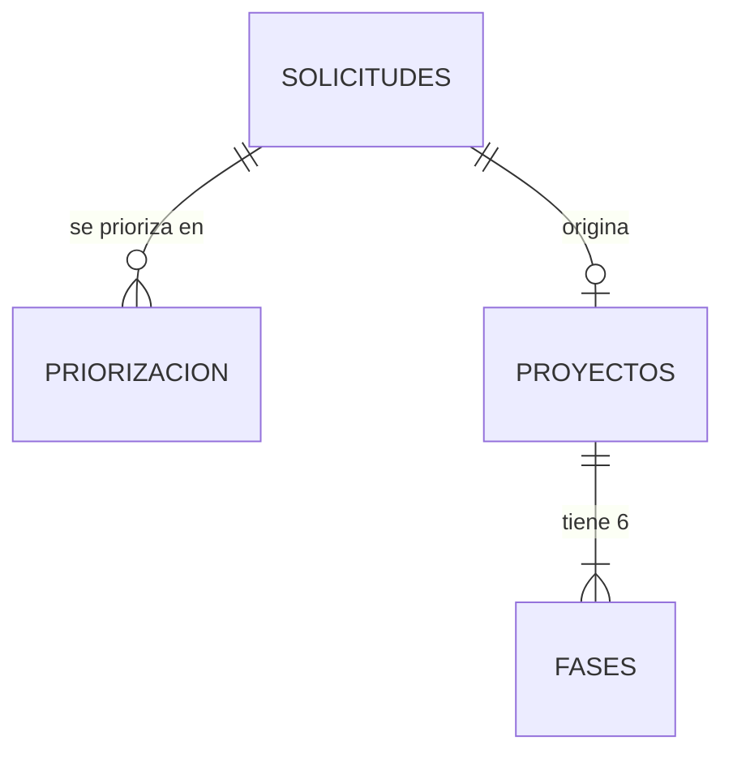

# Modelo de datos (MER)

Modelo entidad-relación de las listas de SharePoint del ciclo **Solicitud → Priorización → Proyecto**. 
La llave universal es el *Radicado de entrada*.

Leyenda: 🔑 PK = llave primaria · 🔗 FK = llave foránea · — = campo estándar

## Solicitudes

| # | Columna | Tipo | Rol | Descripción |
|---|---|---|---|---|
| 1 | Radicado de entrada | string | 🔑 PK | Identificador único. Llave de relación universal |
| 2 | Remitente | string | — | Persona u organización que radicó la solicitud |
| 3 | Asunto | string | — | Descripción breve del asunto de la solicitud |
| 4 | Comuna | string | — | Comuna o corregimiento de la solicitud |
| 5 | Fecha de radicado | date | — | Fecha en que se radicó la solicitud |
| 6 | Fecha de ingreso a la SSP | date | — | Fecha de ingreso a la Secretaría de Servicios Públicos |
| 7 | Fecha de visita técnica | date | — | Fecha en que se realizó la visita técnica |
| 8 | Concepto de la visita | string | — | Resultado conceptual de la visita técnica |
| 9 | Informe de visita técnica | string | — | Ruta o referencia al informe de visita |
| 10 | Fecha de vencimiento | date | — | Fecha límite de respuesta de la solicitud |
| 11 | Próximo de vencimiento | string | — | Alerta de proximidad al vencimiento |
| 12 | Responsable | string | — | Profesional responsable del trámite |
| 13 | Número de radicado respuesta | string | — | Radicado del oficio de respuesta emitido |
| 14 | Fecha de radicado respuesta | date | — | Fecha en que se radicó la respuesta |
| 15 | Viabilidad | string | — | Resultado de viabilidad: Viable / No viable |
| 16 | Estado de solicitud | string | — | Estado actual: Pendiente / En trámite / Cerrada |
| 17 | Concepto de viabilidad | string | — | Justificación técnica del concepto de viabilidad |

## Priorizacion

| # | Columna | Tipo | Rol | Descripción |
|---|---|---|---|---|
| 1 | Radicado de entrada | string | 🔗 FK | FK → SOLICITUDES.Radicado de entrada |
| 2 | Fecha de priorización | date | — | Fecha en que se realizó la evaluación de priorización |
| 3 | Priorizado por | string | — | Nombre del profesional que realizó la priorización |
| 4 | Nombre del proyecto (ref.) | string | — | Nombre de referencia del proyecto en el momento de priorizar |
| 5 | Tipo de sistema (ref.) | string | — | Tipo de sistema: Acueducto / Alcantarillado / Aseo |
| 6 | Corregimiento (ref.) | string | — | Corregimiento o zona de referencia al momento de priorizar |
| 7 | Calidad del agua (10%) | decimal | — | Criterio: calidad del agua — puntaje sobre 10% |
| 8 | Continuidad (10%) | decimal | — | Criterio: continuidad del servicio — puntaje sobre 10% |
| 9 | Cobertura (10%) | decimal | — | Criterio: cobertura del servicio — puntaje sobre 10% |
| 10 | Estado estudios técnicos (10%) | decimal | — | Criterio: estado de estudios técnicos existentes |
| 11 | Estudios técnicos pendientes | string | — | Descripción de estudios técnicos por gestionar |
| 12 | Condición jurídica | string | — | Condición jurídica relevante para la priorización |
| 13 | Gestión jurídica predial (12.5%) | decimal | — | Criterio: gestión jurídica predial — puntaje |
| 14 | Trámites jurídicos por gestionar | string | — | Descripción de trámites jurídicos pendientes |
| 15 | Clasificación del POT (7%) | decimal | — | Criterio: clasificación en el POT vigente |
| 16 | Trámites ambientales (12.5%) | decimal | — | Criterio: trámites ambientales — puntaje |
| 17 | Trámites ambientales por gestionar | string | — | Descripción de trámites ambientales pendientes |
| 18 | Impacto costos prestación (6%) | decimal | — | Criterio: impacto en costos de prestación del servicio |
| 19 | Participación ciudadana (6%) | decimal | — | Criterio: participación ciudadana y legitimidad social |
| 20 | Cobertura viviendas (6%) | decimal | — | Criterio: cobertura de viviendas a beneficiar |
| 21 | Costo / beneficio (10%) | decimal | — | Criterio: relación costo-beneficio del proyecto |
| 22 | Resultado evaluación (%) | decimal | — | Puntaje total resultado de la evaluación de criterios |
| 23 | Observaciones técnicas | string | — | Observaciones adicionales del proceso de priorización |
| 24 | Vigente | string | — | Indica si la priorización está vigente: Sí / No |

## Proyectos

| # | Columna | Tipo | Rol | Descripción |
|---|---|---|---|---|
| 1 | Código proyecto | string | 🔑 PK | Código único del proyecto — formato APSB-XXX |
| 2 | Radicado de entrada | string | 🔗 FK | FK → SOLICITUDES.Radicado de entrada |
| 3 | Nombre del proyecto | string | — | Nombre oficial del proyecto |
| 4 | Descripción del proyecto | string | — | Descripción técnica del alcance |
| 5 | Tipo de sistema | string | — | Acueducto / Alcantarillado / Aseo |
| 6 | Comuna o Corregimiento | string | — | Nombre de la comuna o corregimiento |
| 7 | Número comuna | string | — | Número identificador de la comuna |
| 8 | Vereda o Barrio | string | — | Vereda o barrio específico de intervención |
| 9 | Fecha creación | date | — | Fecha de creación del registro del proyecto |
| 10 | Número de contrato | string | — | Número del contrato asociado |
| 11 | Contratista | string | — | Nombre del contratista ejecutor |
| 12 | Fecha firma contrato | date | — | Fecha de firma del contrato |
| 13 | Presupuesto | decimal | — | Valor total del presupuesto aprobado (COP) |
| 14 | Ejecución financiera | decimal | — | Valor ejecutado financieramente (COP) |
| 15 | Viabilidad — Pct | decimal | — | % de avance de la fase de Viabilidad (0-100) |
| 16 | Viabilidad — Estado | string | — | Estado fase Viabilidad: Pendiente / En curso / Completado |
| 17 | Viabilidad — Fecha | date | — | Fecha de cierre o última actualización de la fase |
| 18 | Planeación — Pct | decimal | — | % de avance de la fase de Planeación |
| 19 | Planeación — Estado | string | — | Estado fase Planeación |
| 20 | Planeación — Fecha | date | — | Fecha de cierre o última actualización de la fase |
| 21 | Diseño — Pct | decimal | — | % de avance de la fase de Diseño |
| 22 | Diseño — Estado | string | — | Estado fase Diseño |
| 23 | Diseño — Fecha | date | — | Fecha de cierre o última actualización de la fase |
| 24 | Contratación — Pct | decimal | — | % de avance de la fase de Contratación |
| 25 | Contratación — Estado | string | — | Estado fase Contratación |
| 26 | Contratación — Fecha | date | — | Fecha de cierre o última actualización de la fase |
| 27 | Ejecución — Pct | decimal | — | % de avance de la fase de Ejecución |
| 28 | Ejecución — Estado | string | — | Estado fase Ejecución |
| 29 | Ejecución — Fecha | date | — | Fecha de cierre o última actualización de la fase |
| 30 | Cierre — Pct | decimal | — | % de avance de la fase de Cierre |
| 31 | Cierre — Estado | string | — | Estado fase Cierre |
| 32 | Cierre — Fecha | date | — | Fecha de cierre o última actualización de la fase |
| 33 | Liquidación — Pct | decimal | — | % de avance de la fase de Liquidación |
| 34 | Liquidación — Estado | string | — | Estado fase Liquidación |
| 35 | Liquidación — Fecha | date | — | Fecha de cierre o última actualización de la fase |
| 36 | Estado operativo | string | — | Estado operativo actual del proyecto |
| 37 | Fecha inicio planeada | date | — | Fecha de inicio planeada del proyecto |
| 38 | Fecha fin planeada | date | — | Fecha de finalización planeada del proyecto |
| 39 | Viabilidad técnica | string | — | Resultado de la viabilidad técnica del proyecto |
| 40 | Ruta informe visita | string | — | Ruta o enlace al informe de visita técnica |
| 41 | Observaciones técnicas | string | — | Observaciones técnicas generales del proyecto |
| 42 | Tiene priorización | string | — | Indica si el proyecto pasó por priorización: Sí / No |

> La lista **Fases** (6 registros por proyecto: Planeación, Diseño, Contratación, Ejecución, Cierre, Liquidación) se documenta en [crear-fases.md](flujos/crear-fases.md).
