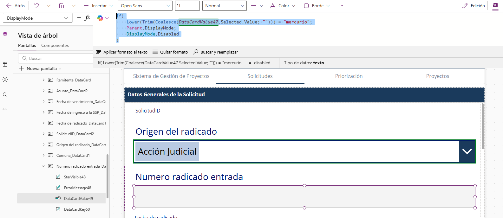

**Documentacion tecnica**

**Control de edicion del campo Numero radicado entrada**

Regla aplicada segun el origen del radicado

| Aplicacion    | Sistema de Gestion de Proyectos               |
|---------------|-----------------------------------------------|
| Modulo        | Solicitudes - Datos Generales de la Solicitud |

# 1. Objetivo

Configurar el campo **Numero radicado entrada** para que solo pueda editarse cuando el campo **Origen del radicado** sea igual a **Mercurio**. Para los demas origenes, el campo queda bloqueado y el radicado se maneja automaticamente por la aplicacion.

# 2. Campos y controles involucrados

| **Elemento**            | **Configuración / descripción**                                                                    |
|-------------------------|----------------------------------------------------------------------------------------------------|
| Origen del radicado     | Control DataCardValue47. Corresponde al desplegable donde se selecciona el origen de la solicitud. |
| Numero radicado entrada | Control DataCardValue49. Corresponde al campo de texto que almacena el radicado de entrada.        |
| Propiedad configurada   | DisplayMode del control DataCardValue49.                                                           |
| Lista de SharePoint     | Solicitudes.                                                                                       |

# 3. Formula aplicada

En el control **DataCardValue49**, propiedad **DisplayMode**, se configuro la siguiente formula:

<table><tbody><tr class="odd"><td>If( 
Lower(Trim(Coalesce(DataCardValue47.Selected.Value; ""))) = "mercurio"; 
Parent.DisplayMode; 
DisplayMode.Disabled 
)</td></tr></tbody></table>

# 4. Explicacion de la logica

| **Elemento**         | **Configuración / descripción**                                                                    |
|----------------------|----------------------------------------------------------------------------------------------------|
| Lower(...)           | Convierte el texto del origen a minusculas para evitar errores por mayusculas o minusculas.        |
| Trim(...)            | Elimina espacios al inicio o al final del valor seleccionado.                                      |
| Coalesce(...; "")    | Evita errores cuando el campo esta vacio, usando una cadena vacia como valor alternativo.          |
| = "mercurio"         | Evalua si el origen seleccionado corresponde a Mercurio.                                           |
| Parent.DisplayMode   | Mantiene el modo normal del formulario. Si el formulario esta en edicion, el campo queda editable. |
| DisplayMode.Disabled | Bloquea el campo cuando el origen es diferente a Mercurio.                                         |

# 5. Comportamiento esperado

| **Origen del radicado**       | **Estado del campo Numero radicado entrada** | **Resultado**                                               |
|-------------------------------|----------------------------------------------|-------------------------------------------------------------|
| Mercurio                      | Editable                                     | El usuario debe ingresar manualmente el numero de radicado. |
| Accion judicial               | Bloqueado                                    | El usuario no puede modificar el campo desde el formulario. |
| Plan desarrollo u otro origen | Bloqueado                                    | El campo queda protegido para evitar digitacion manual.     |
| Sin seleccion                 | Bloqueado                                    | El campo queda bloqueado hasta definir el origen.           |

# 6. Evidencia de configuracion

La siguiente imagen muestra la propiedad DisplayMode configurada en el control del campo Numero radicado entrada:

*Figura 1. Configuracion de DisplayMode para bloquear o habilitar el campo segun el origen del radicado.*

# 7. Validacion funcional

Para validar la configuracion se recomienda realizar las siguientes pruebas dentro de la aplicacion:

> **•** Seleccionar Mercurio en Origen del radicado y confirmar que Numero radicado entrada permite escribir.
>
> **•** Seleccionar Accion judicial u otro origen y confirmar que Numero radicado entrada queda bloqueado.
>
> **•** Guardar un registro de prueba y verificar que el valor se almacene correctamente en la lista Solicitudes.
>
> **•** Abrir nuevamente el registro y confirmar que el comportamiento se conserva en modo edicion.

# 8. Observacion tecnica

La formula utiliza **Parent.DisplayMode** en lugar de **DisplayMode.Edit** para respetar el estado del formulario. De esta forma, si el formulario esta en modo vista o deshabilitado, el campo no se habilita de manera indebida.

